# refEDA tutorial

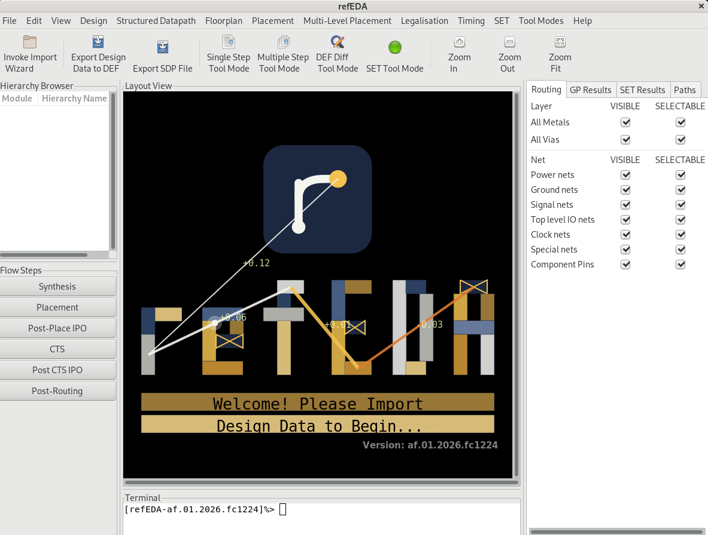

Run refEDA on mapped circuits to study placement, static and asynchronous timing, SET
propagation, register-capture sensitivity, SEU propagation and TMR hardening, physical
separation of redundant registers, and power. Each Tcl script loads its own libraries, inputs, and constraints. Every
exercise can start in a fresh process without using another exercise's results.

Start with [Running the tutorial](#running-the-tutorial). Use the table below to choose
an exercise, [Choosing a PDK](#choosing-a-pdk) to change technology, and [Changing the
design](#changing-the-design) to select a circuit. The [annotated file
tree](#repository-structure) identifies every tutorial source file. See [Results and
figures](#finding-and-checking-your-results) for the saved outputs.

## Exercises

| Part | Exercise | What you will learn | Script |
|---|---|---|---|
| STA | [1. STA first run](#1-sta-first-run) | Load, constrain, analyse and read the timing of one small circuit | [first_run.tcl](STA/First_Run/first_run.tcl) |
| STA | [2. STA commands](#2-sta-commands-and-timing-models) | Compare timing models, inspect delay calculations, apply exceptions and sensitise paths | [Four STA scripts](#sta-command-examples) |
| STA | [3. CDC](#3-clock-domain-crossing-cdc) | Apply asynchronous clock groups, from a small circuit to a full processor | [cdc6_ihp.tcl](STA/CDC/cdc6_ihp.tcl), [black_parrot_cdc.tcl](STA/CDC/black_parrot_cdc.tcl) |
| STA | [4. Async FIFO](#4-asynchronous-fifo) | Constrain two clock domains and inspect FIFO setup timing | [afifo_16x2_ihp.tcl](STA/Async_FIFO/afifo_16x2_ihp.tcl), [ol_fifo_async.tcl](STA/Async_FIFO/ol_fifo_async.tcl) |
| STA | [5. STA vs SPICE](#sta-versus-spice) | Compare path, wire and cell timing with transistor-level simulation | [Seven STA–SPICE scripts](#run-the-cases) |
| STA | [6. Power analysis](#6-power-analysis) | Estimate leakage, switching and internal power from recorded activity | [Four power scripts](#power-examples) |
| IPO | [7. IPO](#7-ipo-incremental-sta-and-timing-optimisation) | Update timing after a cell move and run synchronous ECO optimisation | [Incremental STA](#incremental-sta-after-a-cell-move), [TV80](#synchronous-tv80-timing-optimisation) |
| Glitch | [8. SET analysis](#8-analyse-set-propagation) | Annotate probabilities, propagate particle-induced pulses and check them against Spectre and Xyce | [set_analysis.tcl](SET/set_analysis.tcl), [set_vs_spice.tcl](SET/set_vs_spice.tcl), [set_xyce_bias.tcl](SET/set_xyce_bias.tcl) |
| Glitch | [9. SET mitigation](#9-measure-the-effect-of-set-mitigation) | Measure the area and capture-sensitivity effects of gate upsizing | [set_mitigation.tcl](SET/set_mitigation.tcl) |
| Glitch | [10. SEU analysis and TMR](#10-analyse-seu-propagation-and-harden-registers-with-tmr) | Rank the registers by how far their bit flips propagate, then triplicate the most critical ones | [seu_analysis.tcl](SEU/seu_analysis.tcl), [seu_tmr.tcl](SEU/seu_tmr.tcl) |
| Glitch | [11. SEMT analysis](#11-inject-particle-hits-semt-analysis) | Inject particle hits on the layout, measure single and multiple transients per grid, and run statistical fault injection | [Three SEMT scripts](#semt-scripts) |
| Asynchronous | [12. ASTA](#12-analyse-an-asynchronous-circuit-with-asta) | Trace critical cycles, derive datapath clocks and check relative timing | [Five ASTA scripts](#asta-scripts) |
| Asynchronous | [13. AIPO](#13-optimise-an-asynchronous-circuit-with-aipo) | Measure the effect of asynchronous ECO optimisation on nine placed circuits | [Click control ring](#optimise-the-click-control-ring), [other circuits](#controller-and-arithmetic-circuits) |
| Placement | [14. Global placement](#14-run-global-placement) | Place from a DEF, legalise, and inspect wirelength and density | [global_placement.tcl](Placement/global_placement.tcl) |
| Placement | [15. Detailed placement](#15-run-detailed-placement) | Refine a legal DEF placement with local cell moves | [detail_placement.tcl](Placement/detail_placement.tcl) |
| Placement | [16. Placement from netlist](#16-gate-level-placement) | Create the floorplan, place I/Os, and run global and detailed placement | [gate-level-placement.tcl](Placement/gate-level-placement.tcl) |
| Placement | [17. RADHARD legalisation](#17-separate-redundant-registers-with-radhard-legalisation) | Insert redundant registers and enforce their separation | [radhard_legalisation.tcl](Radhard/radhard_legalisation.tcl) |

The small placement and STA examples are suitable starting points. The full Black Parrot
run is substantially larger than the other examples. Exercise 5 and
`SET/set_xyce_bias.tcl` require Xyce (exercise 5 can also run with Spectre), and
`SET/set_vs_spice.tcl` and `SET/set_spectre_bias.tcl` require Spectre; the other exercises
run without an external simulator.

## Running the tutorial

### Working directory and requirements

Keep `tutorial/` inside the refEDA checkout with the directory layout shown in
[Repository structure](#repository-structure). The placement scripts use helper files
from the parent checkout. From a shell in the refEDA checkout, enter the tutorial
directory:

```bash
cd tutorial
```

Run the remaining shell commands from this directory.

The tool is refEDA. From `tutorial/`, its executable is `../Tool/build/refEDA`. If your executable is installed elsewhere,
replace `../Tool/build/refEDA` in the commands with its location. The executable must support the
commands used by the chosen exercise.

The design inputs and the ASAP7, IHP Open PDK, and SKY130 digital libraries are included
under `Test-Designs/` and `PDK/`. Keep these directories beside the scripts. The Tcl
scripts resolve their input paths relative to their own location, so the shell can stay
in `tutorial/` throughout.

### Large design files (tar.gz parts)

Four design files are larger than a Git host accepts (GitHub refuses files over 100 MB), so
the repository carries them packed as a gzip-compressed tar archive split into parts:
`Test-Designs/large_designs.tar.gz.00`, `.01`, ... (about 80 MB in all for 1.8 GB of files),
with the list of packed files in `large_designs.tar.gz.list` and the SHA-256 checksum of the
archive in `large_designs.tar.gz.sha256`.

| Packed file | Size | Used by |
|---|---|---|
| `Test-Designs/Black-Parrot/bp_processor_asap7.v` | 1.43 GB | [Full Black Parrot CDC timing](#full-black-parrot-cdc-timing) |
| `Test-Designs/Synchronous/netcard.def`, `netcard.v` | 136 MB, 111 MB | `select_design.py netcard` |
| `Test-Designs/Synchronous/leon3mp.def` | 103 MB | `select_design.py leon3mp` |

`python3 scripts/select_design.py` unpacks them for you: every run (including `--default`,
the first command of the tutorial) checks the checksum and extracts the files when one of them
is missing or older than the parts; later runs do nothing. To unpack them by hand instead:

```bash
cat Test-Designs/large_designs.tar.gz.[0-9][0-9] | tar -xzf -
```

Join all parts with `cat` before `tar`; a single part cannot be extracted on its own. If the
checksum does not match, download the parts again. Maintainers repack the files after a
change with `scripts/pack_large_designs.sh`, which replaces the parts, the list and the
checksum; the unpacked files are listed in `.gitignore`.

Python 3.9 or later runs the selectors and plotting helper. Install Matplotlib for the
system `python3` if it is not available:

```bash
sudo apt install python3-matplotlib
```

You can run a Tcl exercise before installing the plotting dependency. Xyce is needed for
the STA–SPICE exercise only; see [exercise 5](#sta-versus-spice). The ML SET models come
with refEDA; see [exercise 9](#optional-ml-set-generation-models).

### Design selection and PDK selection

These are two separate operations:

| Operation | Command | Files affected |
|---|---|---|
| Choose an ASAP7 design such as `mac`, `counter`, or `uart` | `python3 scripts/select_design.py <design>` | Six placement/SET/RADHARD scripts, three timing-driven placement scripts and six STA–SPICE scripts (15 Tcl files). |
| Choose only the STA–SPICE design | `python3 scripts/select_design.py --sta-spice <design>` | Only the six design-selectable scripts under `STA/STAvsSPICE/` (cases 01–05 and 07); always ASAP7. |
| Choose ASAP7 or IHP Open PDK for the switchable examples | `python3 scripts/select_pdk.py <PDK>` | Those six scripts, all five ASTA scripts, and all nine AIPO scripts. |
| Choose an ASTA or AIPO circuit | Run that circuit's Tcl script | Each Tcl has its own fixed circuit. No design-selector command is needed. |
| Choose the SPICE simulator of STA–SPICE | `python3 scripts/select_simulator.py xyce` or `spectre` | Cases 01–05 and 07 under `STA/STAvsSPICE/`; case 06 stays on Xyce. |
| Return everything to the defaults | `python3 scripts/select_design.py --default` | All 28 selectable scripts: ASAP7, with each script's shipped design. |
| Return only the PDK to the default | `python3 scripts/select_pdk.py --default` | The 20 switchable scripts, back to ASAP7. Same as `select_pdk.py ASAP7`. |
| Return the simulator to the default | `python3 scripts/select_simulator.py --default` | The six switchable STA–SPICE scripts, back to Xyce. `select_design.py --default` does not change the simulator. |

`--default` undoes any combination of selections in one step. It switches the PDK back to
ASAP7 and restores each script's shipped design: `mac` for gate-level placement, `uart` for
RADHARD legalisation, `counter` for the other placement, SET and timing-driven scripts,
and `bf_chain` for STA–SPICE. Use it before committing, or whenever you are unsure what a
script is currently set to.

ASTA and AIPO have fixed circuits. For example, `Asynchronous/ASTA/click_control_ring.tcl`
always analyses the two-stage Click ring, and
`Asynchronous/AIPO/optimise_placed_mr0.tcl` always optimises MR0. The PDK selector chooses
the ASAP7 or IHP mapping of that circuit. It rewrites the libraries, mapped
netlist path, units, and relevant technology settings.

`select_design.py mac` leaves every ASTA and AIPO script unchanged. The
[PDK support table](#pdk-support-by-example) below lists the technology choices
for each part of the tutorial.

### First run

Start with the STA first run. It uses a fixed five-cell circuit, so no design or PDK
selection is needed:

```bash
../Tool/build/refEDA -no_gui -f STA/First_Run/first_run.tcl
```

`-no_gui` runs in the terminal, and `-f` names the Tcl script to execute. Check for
`TUTORIAL_COMPLETE`, and also inspect any `ERROR:` messages: the completion marker means
the Tcl reached its end, and a native command can report an error without stopping the
script. [Exercise 1](#1-sta-first-run) explains how to read the reports.

### Run another exercise

From the same shell directory, use the script path listed in its section. For example,
the small conditional-arc example uses its fixed IHP inputs:

```bash
../Tool/build/refEDA -no_gui -f STA/Scripts/whenconditions_ihp.tcl
python3 scripts/plot_results.py
```

Each invocation starts a new tool session. The Python plotting command reads saved files
and rebuilds the figures; it does not launch refEDA or perform another analysis.
Examples that provide terminal reports only are identified in their sections.

If a Tcl error leaves the interactive tool prompt open, enter `exit`, resolve the
reported problem, and rerun the same shell command. Selecting a design or PDK changes
scripts, not saved results. Starting a Tcl script replaces only that example's result
directory. The gallery can therefore contain results from different designs or PDKs;
plotted runs record their inputs in `info.txt`.

### Watch an exercise in the GUI

Every exercise also runs in the refEDA GUI: leave out `-no_gui`. The GUI reads its
interface files from the folder named by `refEDA_INSTALL_DIR`, so set it first. Without
it, the GUI fails as soon as it starts drawing.

```bash
export refEDA_INSTALL_DIR=$PWD/../Tool/build
../Tool/build/refEDA -f Placement/global_placement.tcl
```

Each script ends with `exit`, which closes the window as soon as the script finishes.
To explore the result, comment out that last line before running.

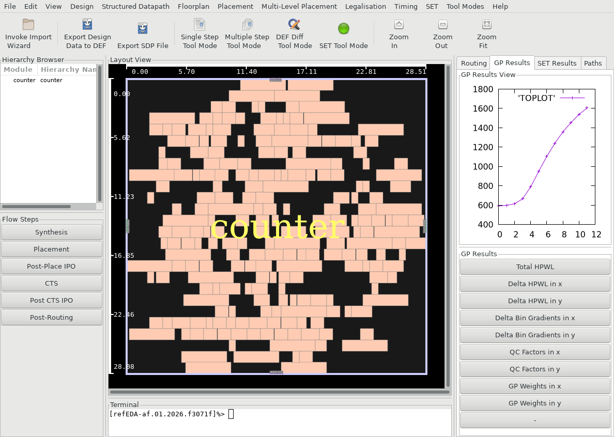

*The GUI after `Placement/global_placement.tcl`. Centre: the layout view of the placed
`counter`. Right: the GP Results tab, with the wirelength (HPWL) of each global-placement
iteration. Left: the hierarchy browser and flow steps. Bottom: the Tcl terminal.*

## Choosing a PDK

### PDK support by example

This table lists the mappings and inputs supplied by this tutorial. A dash
means that the tutorial does not provide that example with that PDK.

| Example | Circuit choice | ASAP7 | IHP Open PDK | SKY130 |
|---|---|---|---|---|
| 1. STA first run | Fixed five-cell circuit | Yes | — | — |
| 2. `STA/Scripts/bf_chain_ASAP.tcl` | Fixed buffer chain | Yes | — | — |
| 2. `STA/Scripts/ff_and_inv_and_ff_ASAP.tcl` | Fixed five-cell timing circuit | Yes | — | — |
| 2. `STA/Scripts/whenconditions_ihp.tcl` | Fixed AND-OR gate | — | Yes | — |
| 2. `STA/Scripts/bumblebeee.tcl` | Fixed reconvergent logic circuit | — | Yes | — |
| 3. Full Black Parrot CDC | Fixed processor | Yes | — | — |
| 3. `STA/CDC/cdc6_ihp.tcl` | Fixed three-clock circuit | — | Yes | — |
| 4. `STA/Async_FIFO/ol_fifo_async.tcl` | Fixed dual-clock FIFO | — | — | Yes |
| 4. `STA/Async_FIFO/afifo_16x2_ihp.tcl` | Fixed 16-entry, two-bit FIFO | — | Yes | — |
| 5. STA–SPICE | Selectable ASAP7 circuit; cases 05 and 07 need matching 1× routed DEF/SPEF | Yes | — | — |
| 6. Power: all four scripts | Fixed c17, c499, or c1908 circuit | — | Yes | — |
| 7. Incremental STA: M65C02 ALU | Fixed ALU, constructed placement | Yes | — | — |
| 7. Incremental STA: AES | Fixed open AES encryption core, constructed placement | — | Yes | — |
| 7. TV80 synchronous optimisation | Separate fixed mapping and DEF for each PDK | Yes | — | Yes |
| 8–9. SET analysis/mitigation | Selectable ASAP7 design; fixed counter for IHP | Yes | Yes: four-bit counter | — |
| 10. SEU analysis and TMR | Fixed `pci_bridge32` | Yes | — | — |
| 11. SEMT: all three scripts | Fixed ASAP7 counter | Yes | — | — |
| 12. ASTA: all five scripts | Fixed circuit in each Tcl | Yes | Yes | — |
| 13. AIPO: all nine scripts | Fixed circuit in each Tcl | Yes | Yes | — |
| 14–15. Global/detailed placement | Selectable ASAP7 netlist/DEF pair; fixed counter/DEF for IHP | Yes | Yes: four-bit counter | — |
| 16. Gate-level placement | Selectable ASAP7 design; fixed counter for IHP | Yes | Yes: four-bit counter | — |
| 17. RADHARD legalisation | Selectable ASAP7 design; fixed counter for IHP | Yes | Yes: four-bit counter | — |

The PDK selector handles the placement, SET, RADHARD, ASTA and AIPO exercises only: 20 Tcl scripts in total. The
examples in the other exercises retain their own PDK libraries. Exercise 5 uses the
design selector; the other fixed examples retain their own circuits and inputs.
For example, `STA/Power/c17.tcl` always uses IHP Open PDK, and
`STA/Scripts/bf_chain_ASAP.tcl` always uses ASAP7, regardless of the last PDK-selector
command.

### Run a switchable example with IHP Open PDK

From `tutorial/`, select the PDK and run the desired Tcl:

```bash
python3 scripts/select_pdk.py IHP-Open-PDK
../Tool/build/refEDA -no_gui -f Placement/gate-level-placement.tcl
python3 scripts/plot_results.py
```

The placement, SET and RADHARD exercises now use the bundled four-bit SG13G2 counter. The two
DEF-based placement flows and the SET/RADHARD flows also load its matching
placed DEF. IHP mitigation upsizes eligible AOI21 cells from drive strength
1 to 2. IHP RADHARD triplicates its four registers and requests 5 µm group
spacing in the 1× layout.

For ASTA or AIPO, run the Tcl for the circuit you want after selecting the
PDK. For example, these commands use the IHP mappings of the Click ring:

```bash
python3 scripts/select_pdk.py IHP-Open-PDK
../Tool/build/refEDA -no_gui -f Asynchronous/ASTA/click_control_ring.tcl
../Tool/build/refEDA -no_gui -f Asynchronous/AIPO/optimise_placed_click_ring.tcl
```

The circuit in each of those scripts stays the Click ring. To run MR0
instead, choose `Asynchronous/AIPO/optimise_placed_mr0.tcl`.

### Return to ASAP7 and choose a synchronous design

```bash
python3 scripts/select_pdk.py ASAP7
python3 scripts/select_design.py mac
../Tool/build/refEDA -no_gui -f Placement/gate-level-placement.tcl
```

Switching back restores the synchronous ASAP7 design and clock settings
saved by `select_pdk.py`. The subsequent `select_design.py mac` explicitly
sets the six placement/SET/RADHARD scripts and six STA–SPICE scripts to MAC. ASTA and AIPO retain
their fixed circuits using their ASAP7 mappings.

The run blocks in the placement, SET and RADHARD exercises explicitly choose ASAP7 and a named design.
For an IHP run, use the IHP pattern above and run the same exercise's Tcl.

`select_pdk.py` rewrites library paths, mapped inputs, timing/load units,
and technology-dependent settings together. Keep numeric timing and load
arguments literal when using it; an expression it cannot safely convert
causes an error before files are written. `period_ps` and `fall_ps` retain
their ps meaning and are converted at the IHP `create_clock` call.
Particle-profile values with explicit `p`/`f` suffixes retain their ps/fC
meaning. See [Measurement settings and units](#measurement-settings-and-units).

## Input formats

| File | Contents and use |
|---|---|
| `.v` | A Verilog netlist mapped to cells in the selected library. The tutorial starts after synthesis. `counter4.rtl.v` is included as a source reference; the scripts load its mapped `.v`. |
| `.lef` / `.tlef` | Technology layers, placement sites, and standard-cell geometry. Cell names and geometry scale must match the netlist and DEF. |
| `.lib` | Liberty timing, capacitance, and power models at the specified process/voltage/temperature corner. |
| `.def` | Floorplan, I/O locations, and placed instances. The routed buffer-chain DEF also supplies route geometry. |
| `.spef` | Extracted wire resistance and capacitance for the routed STA–SPICE case. |
| `.saif` | Recorded logic-state durations and toggle counts used by the power examples. |
| `.sp` / `.pm` | Transistor subcircuits and device models used by the SPICE simulator. |
| `.sdf` | A timing-delay export generated by the timing-utilities example. |

Circuit netlists, DEFs, SPEFs and SAIF files are under `Test-Designs/`; libraries and
transistor models are under `PDK/`. Each Tcl file names its inputs;
[designs.tsv](designs.tsv) lists the designs, relative paths, clock provenance, sizes,
and available activity/parasitic files. Loading a DEF supplies physical data; extracted
wire RC is loaded explicitly where the script calls for it.

## 1. STA first run

Run a complete static timing analysis on the smallest timing circuit in the tutorial
and learn to read its reports. Start here if you are new to the tool.

Open [STA/First_Run/first_run.tcl](STA/First_Run/first_run.tcl). The numbered comments
follow the steps of any STA run:

1. **Load** the cell geometry (LEF), the cell timing (Liberty) and the mapped netlist.
2. **Constrain** the design: a 1 ns clock, I/O delays, an input slew and an output load.
3. **Choose a delay model.** This run uses NLDM. Nothing is placed, so there is no wire RC.
4. **Analyse** setup with the longest paths and hold with the shortest paths.
5. **Summarise** the slack, the worst paths and the cell area.

```bash
../Tool/build/refEDA -no_gui -f STA/First_Run/first_run.tcl
```

Find `Data arrival time` and `Slack` in the terminal. Slack is the margin against the
constraint: `MET` is positive and `VIOLATED` is negative. Setup is met with about
0.83 ns to spare. Hold is violated by about 9 ps, because the inputs arrive with zero
delay against the capturing clock edge.

Check the result: the terminal prints `TUTORIAL_COMPLETE`, and
`results/sta_first_run/result.txt` holds the setup report and the design summary.
Continue with exercise 2, which adds placement, wire RC and exceptions to this circuit.

## 2. STA commands and timing models

Work through timing analysis on small circuits, with one specific question per script.
These examples use the bundled open PDKs and require no SPICE simulation. Run each
script in a fresh process from the tutorial root.

### STA command examples

| Script | What it demonstrates | PDK |
|---|---|---|
| [`bf_chain_ASAP.tcl`](STA/Scripts/bf_chain_ASAP.tcl) | Compare NLDM with lumped RC, CCS with lumped RC, and CCS with pi RC on one generated placement. | ASAP7 |
| [`ff_and_inv_and_ff_ASAP.tcl`](STA/Scripts/ff_and_inv_and_ff_ASAP.tcl) | Inspect setup/hold timing, individual delay calculations, a selected path, logic cones, SDF export, and a false-path exception. | ASAP7 |
| [`whenconditions_ihp.tcl`](STA/Scripts/whenconditions_ihp.tcl) | Apply case analysis and compare default versus conditional timing arcs. | IHP Open PDK |
| [`bumblebeee.tcl`](STA/Scripts/bumblebeee.tcl) | Select and sensitise paths through a chosen branch of reconvergent logic. | IHP Open PDK |

These are fixed examples: the PDK and synchronous-design selectors leave their library
paths and inputs unchanged. ASAP7 uses ps and fF for constraints; IHP Open PDK uses ns
and pF. The native timing reports used by the figures express arrival and slack in ns.
All four scripts use a 20 ps data-input slew and a 5 fF output load.

#### Compare cell and wire models

```bash
../Tool/build/refEDA -no_gui -f STA/Scripts/bf_chain_ASAP.tcl
```

The 21-buffer netlist is shared with STA–SPICE, but this exercise builds a new placement
and compares three STA settings without invoking a simulator. It loads the CCS INVBUF
library, which also contains the NLDM tables. Both LEFs use 1× geometry. A 1 ns clock,
100 ps output budget, and estimated M3 wire RC constrain the chain. Global placement
uses solver 2 and gradient 2 on a square floorplan at 50% utilisation.

Read `nldm_lumped.txt`, `ccs_lumped.txt`, and `ccs_pi.txt` in `results/sta_bf_chain/`.
The placement and interface constraints are identical for all three measurements. The
first comparison changes the cell model; the second changes the wire model. CCS uses
high effort. The clock uses an explicit 1000 ps period and `{0 500}` waveform.

In the GUI, the layout view shows the placement that all three measurements share: the
21 buffers, `bf_chain/U1` to `bf_chain/U21`, between the `in` and `out` pins.

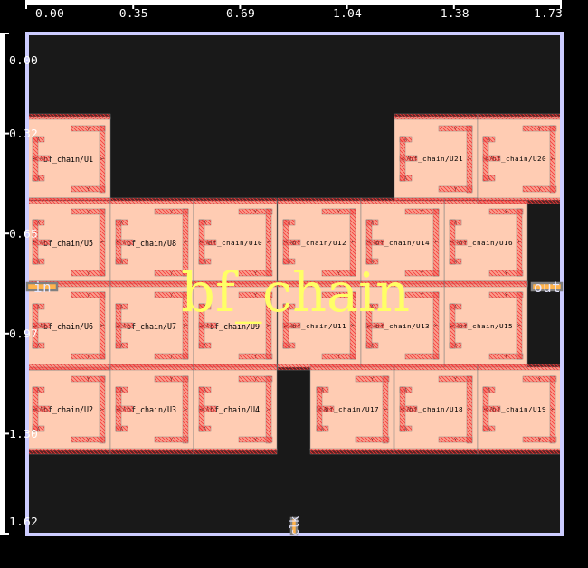

#### Inspect timing utilities

```bash
../Tool/build/refEDA -no_gui -f STA/Scripts/ff_and_inv_and_ff_ASAP.tcl
```

This five-cell circuit contains two registers and a NAND–inverter–NAND path. The script
creates a 5 µm square core and uses the same 1 ns reference clock and 100 ps output
budget as the buffer-chain exercise. It performs setup and hold analysis before calling
`report_global_slack`, then demonstrates:

- `report_top_longest_delay_paths -paths 10`.
- `report_delay_calculation` on `INV/A` and `INV/Y`.
- `report_from_gatepin_to_gatepin_path` from `FF1/Q` to `FF2/D`.
- `save_sdf`, producing `results/sta_timing_utilities/design.sdf`.
- `list_backward_logic_cone` and `list_forward_logic_cone` in the terminal.
- `set_false_path -from ff_and_inv_and_ff/FF1/Q`, followed by another report.

Compare `before.txt` and `after.txt` to see which path remains after the exception. The
commented `draw_*_logic_cone` commands are GUI alternatives. For interactive drawing,
start refEDA with its GUI, remove the final `exit` from this script before running it,
and execute the displayed draw commands.

#### Select conditional timing arcs

```bash
../Tool/build/refEDA -no_gui -f STA/Scripts/whenconditions_ihp.tcl
```

The circuit is one `sg13g2_a21o_1` gate: `out = (a1 & a2) | b1`. The reference clock
period is 10 ns. The script first reports the unconstrained gate, then fixes `a1=0` and
`a2=1` using `set_case_analysis`. It reports the remaining `B1`-to-`X` path with
`set_timingdisableconddefaultarcs 0`, then with that setting changed to `1`.

Compare `default_arcs.txt` and `conditional_arcs.txt` in `results/sta_whenconditions/`.
The latter suppresses the default timing arcs when an applicable conditional arc exists.
`unconstrained.txt` shows the initial path before the side inputs are fixed. No
placement or wire RC is used.

#### Sensitise a selected path

```bash
../Tool/build/refEDA -no_gui -f STA/Scripts/bumblebeee.tcl
```

The supplied circuit contains five registers and reconvergent AND/OR logic. The
instances named `INV1` and `INV2` are buffers; their inherited names are preserved so
that the selected path matches the supplied command.

After a 50% utilisation placement with ten global-placement iterations, the script
requests two true paths from `FF1/CLK` to `FF4/D`, through `INV1/A`:

```tcl
get_timing_paths -corner 0 -longest -mode blcall \
    -from bumblebeee/FF1/CLK -to bumblebeee/FF4/D \
    -through bumblebeee/INV1/A -true 2 -file $out_dir/sensitised_paths.txt
```

Read the sensitisation messages and `results/sta_bumblebeee/sensitised_paths.txt`. This
command runs without the GUI or an external simulator. The input and `cdc6` both omitted
their register reset connections; the copied netlists explicitly tie those resets
inactive through an open-PDK tie-high cell.

In the GUI, the five registers are labelled `FF1` to `FF5`; the buffers and AND/OR gates
sit in the narrow column beside them. Both requested paths start at `FF1` and end at `FF4`.

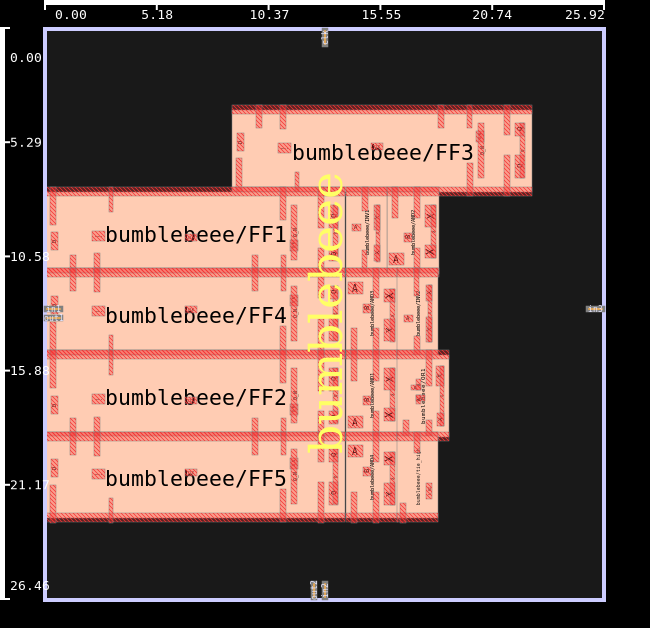

#### Generate the STA figures

```bash
python3 scripts/plot_results.py
```

The gallery includes `sta_bf_chain_comparison`, `sta_whenconditions_comparison`,
`sta_cdc6_comparison`, `sta_afifo_comparison`, and `sta_timing_utilities_comparison`.
Each shows the reported path arrival and slack for the saved settings. The selected
critical path can change when exceptions or case analysis change; use the reports to
identify that path. The path-sensitisation example produces a text path report rather
than an additional figure.

## 3. Clock domain crossing (CDC)

Declare independent clocks and see which timing paths the exceptions remove. Run the
small example first; the full processor is a much larger run of the same idea.

### Declare asynchronous clock domains

```bash
../Tool/build/refEDA -no_gui -f STA/CDC/cdc6_ihp.tcl
```

The circuit contains five registers, four clock buffers, two NAND gates, and one added
tie-high cell. All three clocks have 2 ns periods. As in the supplied demonstration, the
data inputs and both outputs are referenced to `clk1`; the output budget is 0.5 ns. In
particular, `out2` is driven by a `clk2` register while its output constraint references
`clk1`.

After placement, inspect `results/sta_cdc6/before.txt`. Then inspect `after.txt`,
produced after:

```tcl
set_clock_groups -group {clk1} -group {clk2} -group {clk3} -asynchronous
```

The cross-domain check to `out2` is excluded, while the `clk1`-to-`out1` check remains.
This demonstrates timing exceptions and their effect on path selection. It does not
establish that the circuit safely transfers data between these clocks.

In the GUI, the five registers are the large cells `_U1`, `_U2`, `_U3`, `_U6` and `_U7`.
The narrow cells are the clock buffers, the NAND gates and the tie-high cell.

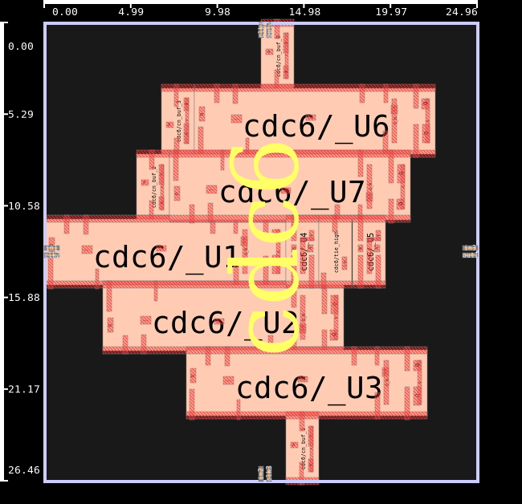

### Full Black Parrot CDC timing

Apply asynchronous clock groups to the full Black Parrot processor and inspect setup
timing within its clock domains.

[`black_parrot_cdc.tcl`](STA/CDC/black_parrot_cdc.tcl) loads the full ASAP7 processor with
2,191,516 cells. It declares `clk_i` with a 1 ns period and `rt_clk_i` with a 50 ns
period, preserving the supplied 500 ps falling edges. Asynchronous clock groups exclude
timing paths between these domains; reset-origin paths are also excluded. Paths within
each domain remain timed.

This is the largest input in the tutorial: the mapped netlist is about 1.43 GB and ships
packed (see [Large design files](#large-design-files-targz-parts)); run
`python3 scripts/select_design.py --default` once to unpack it. Use an
executable that implements `set_clock_groups -asynchronous` and supports at least 1,695
special nets. These are requirements for this full-processor example; the small `cdc6`
run above checks clock-group behaviour on a much smaller circuit.

With a compatible executable, run from the tutorial root:

```bash
../Tool/build/refEDA -no_gui -f STA/CDC/black_parrot_cdc.tcl
```

Inspect the clock report, longest setup path, global setup violations, and area. The
saved summaries are in `results/black_parrot_cdc/result.txt`. This exercise demonstrates
setup timing with asynchronous clock exceptions. Metastability safety and CDC protocol
correctness require separate analysis.

## 4. Asynchronous FIFO

Constrain the two clock domains of a dual-clock FIFO and inspect its setup timing.

### Constrain the small asynchronous FIFO

```bash
../Tool/build/refEDA -no_gui -f STA/Async_FIFO/afifo_16x2_ihp.tcl
```

The mapped FIFO has 16 two-bit memory entries and five-bit pointers, including the wrap
bit. The filename describes those dimensions. It contains 249 cells and 72 registers.

The read clock is 2 ns; the write clock is 3 ns. Read requests and read-side outputs use
`i_rclk`. Write requests, write data, and write-side outputs use `i_wclk`. Each output
budget is 1 ns, and reset-origin paths are excluded. The input and output budgets are
assigned to their respective domains before the timing exceptions are added.

The script saves a report before clock grouping and another after declaring the read and
write clocks asynchronous. Check `before.txt` and `after.txt` in `results/sta_afifo/`
and inspect the reported launch/capture clocks. The run uses cell timing without
placement or wire RC. Pointer-bus skew, metastability, and FIFO protocol correctness
require separate analysis.

### Dual-clock FIFO with SKY130

Declare two clock domains, apply their I/O budgets, and inspect setup timing in a mapped
asynchronous FIFO.

[`ol_fifo_async.tcl`](STA/Async_FIFO/ol_fifo_async.tcl) loads the `olo_base_fifo_async` netlist
from `Test-Designs/SKY130/` and the SKY130 HD technology LEF, merged cell LEF, and 1.8
V, 25 °C TT Liberty from `PDK/SKY130/`. The netlist contains 15,473 cells and 188
flip-flops.

Run from the tutorial root:

```bash
../Tool/build/refEDA -no_gui -f STA/Async_FIFO/ol_fifo_async.tcl
```

1. Declare `In_Clk` with a 2 ns period and `Out_Clk` with a 10 ns period.
2. Assign the write-side inputs and outputs to `In_Clk` and the read-side
   inputs and outputs to `Out_Clk`. Each domain uses a 1 ns I/O delay.
3. Apply 0.1 ns input transitions and a 0.01 pF output pin load.
4. Report the clocks, the longest setup path, global setup violations, and
   area. The terminal prints the number of ports assigned to each domain.
   Clock and setup summaries are saved to `results/ol_fifo_async/result.txt`.

This script applies the two declared waveforms without asynchronous clock exceptions.
Its reports therefore include timing relationships between the clock domains. It loads
no placement or extracted wire RC. The supplied netlist has high fanout and substantial
timing-table extrapolation, which produce large setup violations. Use the run to inspect
constraints and model behaviour. The small IHP FIFO above demonstrates the
effect of asynchronous clock groups explicitly. Neither report establishes FIFO protocol
correctness or metastability safety.

The PDK and synchronous-design selectors retain this example's fixed SKY130 inputs.
Reports are shown in the terminal and saved as text.

<a id="sta-versus-spice"></a>

## 5. Compare STA with SPICE

See how cell and wire timing models compare with transistor-level simulation, both along
a path and at its endpoint.

The five scripts under [STA/STAvsSPICE/](STA/STAvsSPICE/) compare the selected
ASAP7 design with transistor-level simulation. The Python design selector rewrites
the Tcl inputs and clock values. Each Tcl retains its complete setup and runs directly
in a fresh refEDA process.

### Select the circuit

To change STA–SPICE without changing the placement or reliability exercises:

```bash
python3 scripts/select_design.py --sta-spice counter
```

The normal `python3 scripts/select_design.py counter` command configures both groups:
six placement/SET/RADHARD scripts and six STA–SPICE scripts. ASTA, AIPO, power,
incremental STA and the fixed small STA examples keep their own circuits.

Use `--list` to see the available designs and whether each has routed SPEF inputs.
All twelve synchronous ASAP7 choices can configure cases 01–04. Start with `bf_chain`, because designs with resettable flops such as `counter`
currently stop with `Can NOT Find Reset pin of driver component` and simulate no paths;
the larger circuits can take substantially longer to sensitise and simulate. `simple`
has only three cells and includes a scan flip-flop, so it provides little path variety.
The selector checks cell coverage in the bundled 1× LEF and transistor subcircuits.

The ordinary synchronous DEFs use 4× geometry. For these inputs, the selector creates
`Test-Designs/STA-SPICE/selected_1x.def`. It multiplies the DEF database-units-per-micron
value by four and divides real-valued core-box properties by four. Integer coordinates
stay intact, giving a physical 1× placement without coordinate rounding. This generated
file is replaced on the next selection. The original netlist and DEF stay unchanged.
Run the selector after cloning or changing designs to create this input.

The buffer chain remains available:

```bash
python3 scripts/select_design.py bf_chain
```

`bf_chain` configures only STA–SPICE. It keeps the other six exercises unchanged.
Its netlist, 1× placement, routed DEF and SPEF are supplied under
`Test-Designs/STA-SPICE/`. Its `clk` constraint is a virtual reference clock because
the combinational chain has no clock input.

Two larger combinational circuits follow the same pattern: the ISCAS-85 benchmarks `c499`
(161 cells, a 32-bit error-correction circuit) and `c1908` (177 cells), mapped, placed and
routed in ASAP7. Each has its netlist, 1× placement, routed DEF and SPEF under
`Test-Designs/STA-SPICE/`, and like `bf_chain` they configure only STA–SPICE:

```bash
python3 scripts/select_design.py --sta-spice c499
python3 scripts/select_design.py --sta-spice c1908
```

Unlike the buffer chain, these circuits have many reconvergent paths through XOR gates and
full adders, so path sensitisation takes longer and the results are less uniform. See
[Larger circuits: c499 and c1908](#larger-circuits-c499-and-c1908).

### Set up Xyce

The STA–SPICE scripts simulate their paths with Xyce by default (or with Spectre, see
[Use Spectre instead of Xyce](#use-spectre-instead-of-xyce)), and `SET/set_xyce_bias.tcl` its SET
generation decks. Xyce is the open source circuit simulator of Sandia National
Laboratories; get the source code and the build instructions from
<https://github.com/Xyce/Xyce.git>. Put the `Xyce` executable on `PATH` in the shell that
starts refEDA, then check that it is found:

```bash
export PATH=/path/to/xyce/bin:$PATH
command -v Xyce
```

The tested version is Xyce 7.10. The scripts pass Xyce-format device models and cell
subcircuits through `-include`, using `PDK/ASAP7/models/7nm_TT_xyce.pm` and
`PDK/ASAP7/asap7sc7p5t_28/CDL/xAct3D_extracted/asap7sc7p5t_28_R_xyce.sp`, at 0.7 V and
25 °C. `-setupsubcircuit` still names the original `asap7sc7p5t_28_R.sp`. NLDM cases load
all five RVT logic/sequential library groups, and CCS cases load their five CCS
counterparts. The additional CCS groups are bundled as gzip-compressed files and unpack
automatically when the selector runs.

These are fixed ASAP7 exercises; `select_pdk.py` does not change their technology.

### Use Spectre instead of Xyce

To run the same cases with Cadence Spectre instead, put `spectre` and its licence settings in
the shell that starts refEDA, then switch the scripts:

```bash
command -v spectre
python3 scripts/select_simulator.py spectre
python3 scripts/select_simulator.py --list
python3 scripts/select_simulator.py --default
```

The selector rewrites one block in each switchable script, between `# SPICE simulator` and
`# End SPICE simulator`: the simulator name, the cell subcircuits for `-setupsubcircuit`, the
transistor models for `-include`, and the command option (`-spectre`, or none for Xyce). Spectre
reads the HSPICE-format `PDK/ASAP7/models/7nm_TT.pm` and the cell CDL `asap7sc7p5t_28_R.sp`;
Xyce reads the `_xyce` versions. Each run records its simulator in `info.txt`. `--list` shows the
current simulator of every SPICE script, including those that support only one:

| Script | Simulator |
|---|---|
| Cases 01–05 (`get_timing_paths -spice`) and 07 (`compare_delay_calculation_against_spice`) | Xyce or Spectre, chosen by the selector |
| Case 06 (`estimate_detailed_RC_model_delay_and_slew`) | Xyce only |
| `SET/set_vs_spice.tcl`, `SET/set_spectre_bias.tcl` | Spectre only |

The two simulators agree closely. On `bf_chain`, every pin of every path in cases 01 to 05 is
within 0.12 ps between Xyce and Spectre, and the end-to-end STA-versus-SPICE percentages match to
within 0.03 points. Spectre is also faster here: 7 to 18 s per case against 14 to 24 s.

### Run the cases

From `tutorial/`, select a small design and run the four cases that need only a placement:

```bash
python3 scripts/select_design.py --sta-spice counter
../Tool/build/refEDA -no_gui -f STA/STAvsSPICE/01_nldm_no_rc.tcl
../Tool/build/refEDA -no_gui -f STA/STAvsSPICE/02_ccs_no_rc.tcl
../Tool/build/refEDA -no_gui -f STA/STAvsSPICE/03_nldm_lumped_rc.tcl
../Tool/build/refEDA -no_gui -f STA/STAvsSPICE/04_nldm_pi_rc.tcl
python3 scripts/plot_results.py
```

| Script | What it compares with SPICE |
|---|---|
| [`01_nldm_no_rc.tcl`](STA/STAvsSPICE/01_nldm_no_rc.tcl) | NLDM cell timing without wire RC. |
| [`02_ccs_no_rc.tcl`](STA/STAvsSPICE/02_ccs_no_rc.tcl) | Fast-effort CCS without wire RC, using the same selected placement. |
| [`03_nldm_lumped_rc.tcl`](STA/STAvsSPICE/03_nldm_lumped_rc.tcl) | NLDM with estimated lumped M3 wire RC. |
| [`04_nldm_pi_rc.tcl`](STA/STAvsSPICE/04_nldm_pi_rc.tcl) | NLDM with a pi network using the same M3 settings and placement as case 03. |
| [`05_ccs_spef_rc.tcl`](STA/STAvsSPICE/05_ccs_spef_rc.tcl) | Fast-effort CCS with detailed RC from that design's matching native 1× routed DEF and SPEF, and no output load. |

Case 05 has supplied routed inputs for `bf_chain`, `c499` and `c1908`:

```bash
python3 scripts/select_design.py bf_chain
../Tool/build/refEDA -no_gui -f STA/STAvsSPICE/05_ccs_spef_rc.tcl
python3 scripts/plot_results.py
```

Run in the GUI, the cases show the difference in their inputs. Cases 01 to 04 load only
the placement; case 05 also loads the routed nets from the DEF, and their parasitics
from the SPEF:

| Cases 01 to 04: placed cells | Case 05: placed cells and routed nets |
|---|---|
| 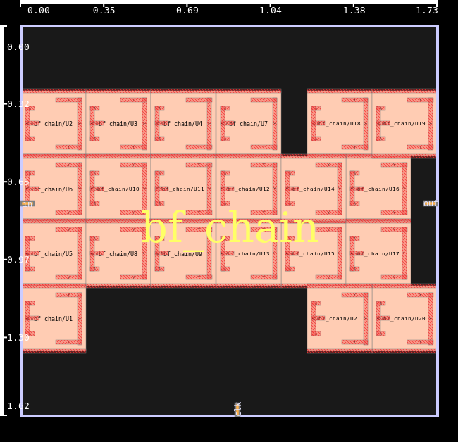 | 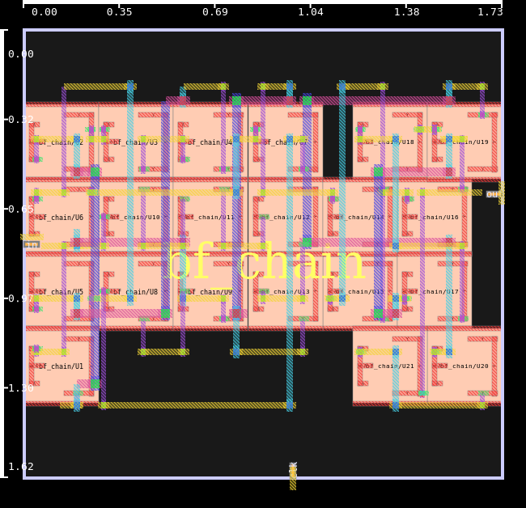 |

To compare all five model cases on one design, select `bf_chain` or `c499` and rerun all
five scripts. On `c1908`, case 05 did not finish within 15 minutes in the path search, so use
cases 01 to 04 there. If a design lacks routed inputs, the selector writes a clear error at the top
of case 05. That script stops before deleting results or loading a different circuit.
It never substitutes the buffer chain's SPEF. To enable case 05 for a new design,
provide matching native 1× routed DEF/SPEF files in its `designs.tsv` row.

Each script uses the selected catalogue clock and falling edge. The I/O assumptions
stay fixed at 50 ps input delay, 100 ps output delay, 20 ps input transition and 5 fF
output load, except that case 05 sets no output load. Once SPEF is loaded, this build's
STA does not apply `set_load`, while the SPICE deck would still include the capacitor,
so the two sides would compare different circuits at the output. These are
demonstration constraints. Each script reports graph-based STA,
then requests two sensitised paths and simulates the paths the tool finds in Xyce.
Path search can be expensive on reconvergent circuits. Different paths can have the
same endpoint transition; general designs do not necessarily produce one rising and
one falling path. The path-based comparison need not match the graph-based report.

Outputs retain their existing fixed directories, such as `results/01_nldm_no_rc/`.
Each contains the selected design and constraints in `info.txt`, exported
`comparison_path_*.csv` files, SPICE decks and simulator logs. A rerun replaces only
that case's folder. Changing the selected design does not rerun cases or erase older
ones. Rerun every case you want to compare under the new selection.

### Read the comparison

Run `python3 scripts/plot_results.py` after the native processes finish, then open the
usual `results/figures/index.html` gallery.

`sta_spice_path_profiles` shows one row per completed model case, labelled with its
actual saved design. The left panel shows cumulative delay and the right shows slew
at cell outputs. Solid lines show STA and dashed lines show SPICE. Each pair follows
its own numbered path. Pin directions come from the bundled LEF, so outputs such as
`QN`, `SN` and `CON` are included as well as `Y`. The curves can have different
endpoints and lengths; the horizontal axis is a sample index along each path.

Cumulative delay subtracts each model's first arrival, excluding the applied launch
arrival. The final point includes the endpoint wire. The plot converts native CSV
arrival and slew values from ns to ps.

`sta_spice_error_summary` shows end-to-end delay error, median cell-output slew error,
and worst cell-output slew error for each numbered path:

```text
signed error (%) = 100 × (STA − SPICE) / SPICE
```

Positive values mean STA predicts a higher value. The worst slew error has the largest
absolute magnitude, with its sign retained. Missing paths and unavailable positive
references remain `N/A`. The plotter accepts one or two exported paths and requires a
matching simulator log reporting a completed run for every plotted path.
The completion marker alone does not establish successful simulation.

### Compare wire delay and slew net by net

[`06_wire_rc_awe_vs_xyce.tcl`](STA/STAvsSPICE/06_wire_rc_awe_vs_xyce.tcl) isolates the
interconnect. It reads extracted ASAP7 parasitics, selects the nets with the largest wire
capacitance, and drives each net directly with a step and a 50 ps ramp. For every
receiver it compares the tool's AWE delay and slew with an Xyce simulation of the same RC
network, so there is no cell delay in the comparison.

Xyce must be on `PATH`. Choose the design and number of nets with environment variables:

```bash
../Tool/build/refEDA -no_gui -f STA/STAvsSPICE/06_wire_rc_awe_vs_xyce.tcl
WIRE_DESIGN=fpu WIRE_NETS=50 ../Tool/build/refEDA -no_gui -f STA/STAvsSPICE/06_wire_rc_awe_vs_xyce.tcl
```

`WIRE_DESIGN` defaults to `des`, and `WIRE_NETS` to 20. The bundled designs are `des`,
`des3`, `fpu`, `mc_top`, `fanout_5`, `fanout_10`, `fanout_20` and `fanout_50`. Each has a
signoff-extracted SPEF and its matching netlist under `Test-Designs/Wire-RC/`.

Read `results/wire_rc_<design>/summary.csv`, which has one row per waveform and
receiver with the Xyce delay and slew, the AWE delay and slew, and their percentage
errors, all in ns. A ramp normally agrees more closely than a step. An AWE delay of 0
with a 100% error means the solver failed on that net (`GSL Library Reports ERROR` in
the log), so report those nets separately rather than averaging them in.

Receiver pin capacitances are left out on purpose: `-addpincapacitance` adds them to AWE
but not to the Xyce deck, so with that option the two sides model different circuits.

### Compare one driver and its routed net

[`07_driver_wire_rc_vs_xyce.tcl`](STA/STAvsSPICE/07_driver_wire_rc_vs_xyce.tcl) sits between
the path cases and case 06. It takes one driver cell, the routed net it drives from the SPEF,
and every receiver on that net, and compares the cell delay plus wire delay that STA
calculates with an Xyce simulation of exactly that circuit
(`compare_delay_calculation_against_spice ... -xyce -includewires`).

The script picks the driver automatically: the output pin that drives the SPEF net with the
largest total capacitance. Set `DRIVER_PIN` to choose another one. It follows the STA–SPICE
design selection and needs a routed DEF and SPEF, so it runs on `bf_chain`, `c499` and
`c1908`. It runs with Xyce or, after `select_simulator.py spectre`, with Spectre; on `c1908` the
two simulators differ by at most 0.8 ps on any pin.

```bash
python3 scripts/select_design.py --sta-spice c1908
../Tool/build/refEDA -no_gui -f STA/STAvsSPICE/07_driver_wire_rc_vs_xyce.tcl
DRIVER_PIN=c1908/U286/Y ../Tool/build/refEDA -no_gui -f STA/STAvsSPICE/07_driver_wire_rc_vs_xyce.tcl
python3 scripts/select_design.py --default
```

Each run takes about 12 s. Read `results/07_driver_wire_rc/driver_wire_comparison.csv`: one row
per transition and pin (the driver's input, the driver output, each receiver) with the STA and
Xyce delay and slew and their errors in percent. `info.txt` records the chosen driver.

| Design | Driver chosen | Receivers | Delay error | Slew error |
|---|---|---|---|---|
| `bf_chain` | `U13/Y`, BUFx2 | 1 | +0.2% | −6% to −7% |
| `c499` | `U271/Y`, XNOR2 | 7 | +0.6% to +0.9% | −17% to −19% |
| `c1908` | `U343/Y`, NOR2 | 13 | +1.8% to +4.2% | −8% to −9% |

The delay at every receiver differs from the driver's by only a few tenths of a percent: on
these short routed nets most of the error is in the cell, not the wire. STA predicts a lower
slew than Xyce on every net, as in case 05.

### Larger circuits: c499 and c1908

On `c499` and `c1908` the same five cases disagree with Xyce far more than on the buffer chain.
End-to-end delay error, two sensitised paths each, measured as for the buffer chain:

| Case | `c499` | `c1908` | Run time `c499`, `c1908` |
|---|---|---|---|
| 01 NLDM, no RC | +25.8%, +25.5% | +25.5%, +25.8% | about 30 s, 29 s |
| 02 CCS, no RC | +21.5%, +28.7% | +20.1%, +20.4% | 69 s, 108 s |
| 03 NLDM, lumped RC | −9.6%, −7.1% | −3.2%, −2.7% | 31 s, 27 s |
| 04 NLDM, pi RC | +14.4%, +19.7% | +11.4%, +11.8% | 38 s, 97 s |
| 05 CCS, routed SPEF | +18.4%, +18.5% | did not finish in 15 min | 336 s, — |

Look at the per-pin increments in `comparison_path_0.csv` rather than only the end point. On
`c499` case 01, two full-adder arcs (`FAx1`, input A to output SN) account for 72 of the 88 ps
difference: STA gives 82 and 67 ps, Xyce 34 and 44 ps. Every other cell on the path agrees
within a few picoseconds, and the wires agree exactly.

The reason is the timing arc STA uses. The library gives FAx1 A-to-SN four conditional arcs,
one for each value of the other two inputs (`when (B * !CI)` and so on), and a default arc that
covers all of them and is the slowest. The sensitised path fixes those inputs, and Xyce
simulates that one state, but STA still uses the default arc. This is the same effect as the
conditional-arc exercise (`STA/Scripts/whenconditions_ihp.tcl`), now on a real circuit.
`set_timingdisableconddefaultarcs 1` alone does not change the result here, because without
case analysis STA does not know which condition applies.

## 6. Power analysis

Inspect leakage, switching, and internal power using the supplied activity data, then
examine what static probabilities alone provide.

### Power examples

| Script | Circuit | Cells | Activity and reports |
|---|---|---:|---|
| [`c17.tcl`](STA/Power/c17.tcl) | c17 | 6 | Supplied SAIF; total leakage, switching, and internal power, plus cell/module tables. |
| [`nosaif_c17.tcl`](STA/Power/nosaif_c17.tcl) | c17 | 6 | Initial probabilities of 0.5 followed by propagation; state-weighted leakage power. |
| [`c499.tcl`](STA/Power/c499.tcl) | c499 | 177 | Supplied SAIF; total power components and cell/module tables. |
| [`c1908.tcl`](STA/Power/c1908.tcl) | c1908 | 218 | Supplied SAIF; total power components and cell/module tables. |

All four scripts load the bundled IHP Open PDK at 1.20 V and 25 °C. They use a 10 ns
reference clock, zero input/output delays, 20 ps input transitions, and 5 fF output
loads. The clock port is a timing reference on these combinational benchmarks. No
placement or wire RC is loaded. The selectors leave these fixed circuits and their
activity files unchanged.

Run the examples directly:

```bash
../Tool/build/refEDA -no_gui -f STA/Power/c17.tcl
../Tool/build/refEDA -no_gui -f STA/Power/nosaif_c17.tcl
../Tool/build/refEDA -no_gui -f STA/Power/c499.tcl
../Tool/build/refEDA -no_gui -f STA/Power/c1908.tcl
python3 scripts/plot_results.py
```

Start with `c17.tcl`. `read_saif` annotates the matching mapped circuit, and
`report_timing` supplies delay and slew information needed by the power calculations.
The script then reports:

- **Leakage power:** cell leakage weighted by the annotated logic states.
- **Switching power:** power associated with charging and discharging net loads.
- **Internal power:** library-modelled energy dissipated inside the cells.

`list_components_power_info` provides the per-cell breakdown, and
`list_verilog_modules_power_info` provides module totals. The tool prints its units:
total leakage uses pW, while switching and internal totals use mW with this library. The
cell/module tables use W. The plot converts all three components to µW.

The SAIF files have a 1 fs timescale and a duration of 20,000,000,000 units,
representing 20 µs of recorded activity. Their copied hierarchy paths have an added
`tb.` prefix so this reader maps both top-level ports and cell pins correctly. Toggle
counts, dwell times, and cell names are unchanged. The examples reuse these files and do
not invoke the simulator that generated them.

`nosaif_c17.tcl` sets probabilities to 0.5 and propagates them through the logic before
reporting leakage. Static probabilities do not supply timed toggle activity. The tested
build returns `NaN` for switching and internal power in this mode, so this example
reports leakage only. Use the SAIF example for the dynamic-power components.

Check the result: each script prints its reports and stores them in
`results/power_<script stem>/result.txt`, with its PDK, activity mode, and completion
marker in `info.txt`. For example, `nosaif_c17.tcl` writes to
`results/power_nosaif_c17/`. Each rerun replaces that example's earlier result.

Open `power_summary` in the gallery. Its three panels show leakage, switching, and
internal power for the saved cases. The probability-only case labels the unavailable
dynamic components as `Activity not supplied`. These estimates describe the supplied
activity, interface loads, and cell models; the scripts do not establish
workload-independent or extracted-layout power accuracy.

## 7. IPO: incremental STA and timing optimisation

Update timing after a single placement change, then let the optimiser change the design.

### Incremental STA after a cell move

These examples compare two ways of updating setup timing after one placement ECO.
Both analyses use the same moved design and the same constraints. The initial full
analysis establishes the timing state needed by the incremental call.

| Script under `IPO/incremental_sta/` | Circuit and PDK | Clock | Moved instance |
|---|---|---|---|
| [`asap7_M65C02_ALU_full_vs_inc.tcl`](IPO/incremental_sta/asap7_M65C02_ALU_full_vs_inc.tcl) | M65C02 ALU, 1,061 ASAP7 cells, 64 registers | 300 ps | `M65C02_ALU/U504` |
| [`ihp_aes_full_vs_inc.tcl`](IPO/incremental_sta/ihp_aes_full_vs_inc.tcl) | AES encryption core, 10,677 SG13G2 cells, 562 registers | 2 ns | `aes_cipher_top/_10532_` |

From `tutorial/`, run either script in a fresh process:

```bash
../Tool/build/refEDA -no_gui -f IPO/incremental_sta/asap7_M65C02_ALU_full_vs_inc.tcl
../Tool/build/refEDA -no_gui -f IPO/incremental_sta/ihp_aes_full_vs_inc.tcl
python3 scripts/plot_results.py
```

Each script loads its own libraries and mapped Verilog, constructs a floorplan at
50% utilisation, places I/Os, runs global placement, and legalises it. NLDM and estimated
pi wire RC remain fixed throughout. The scripts set zero input/output delays and exclude
the reset input from timing. They then perform:

1. Full setup analysis with backannotation to initialise the timing state.
2. `eco_move_cell -coordinate {1 1} <instance>` to change one cell's location.
3. `report_timing -corner 0 -longest -incremental -backannotate` to update affected timing.
4. Full setup analysis again, without another move or legalisation.

Compare **the two post-move reports**. The arrival time, slack, setup WNS and endpoint
TNS should agree at the displayed precision. Comparing either of them with the initial
report answers a different question: what the cell move changed. A move can affect
endpoint totals even when the worst path stays the same.

`report_TNS -longest` and `report_global_timing -longest` report different aggregates in
this build. The former sums the native longest-slack values, while the latter gives the
setup endpoint summary. Compare each command with itself across the two post-move
phases. Negative slack is expected under these demonstration constraints.

The printed millisecond values time only the `report_timing` calls. Placement, loading,
the ECO, and the following aggregate reports are outside the measurement. A single run
illustrates the cost of this particular update; it does not establish a general speedup.

The M65C02 run writes `results/sta_incremental_m65c02/`; AES writes
`results/sta_incremental_aes/`. Each contains `runtime.tsv`, `moved.def`, and
`complete.txt`. The plotter adds `sta_incremental_m65c02_runtime` and
`sta_incremental_aes_runtime` to the figure gallery when those runs finish.
The full timing reports stay visible in the terminal. The deliberate move can create
overlap, so `moved.def` is an ECO snapshot rather than a finished legal placement.

The supplied China 2026 scripts provide the full/incremental/full sequence and the
cell move. This integration adapts their inputs as follows:

- M65C02 uses the bundled ASAP7 1× RVT TT NLDM libraries rather than the supplied
  older CCS library. Five legacy asynchronous flops use the matching current-library
  flop with active-low controls; one shared inverter converts their active-high control.
  `U504` and the remaining instance names stay intact. The clock is explicitly 300 ps.
- AES uses the open `aes_cipher_top` encryption RTL, synthesised to IHP Open PDK SG13G2.
  It replaces the original IHP 0.25 µm AES design. Its architecture, placement, and moved
  instance differ from that original. No IHP 0.25 µm library or saved-design files are
  included. The RTL, licence and synthesis recipe are under `Test-Designs/STA/AES-IHP/`.

Neither selector rewrites these fixed examples. See
[`Test-Designs/STA/README.md`](Test-Designs/STA/README.md) for input provenance and the
optional synthesis command.

### Synchronous TV80 timing optimisation

These two examples load a placed TV80 processor and call `ipo_optimise` to resize or
buffer cells for setup timing. This is synchronous, clock-constrained IPO. The
asynchronous examples under `Asynchronous/AIPO/` use event-cycle timing and a different optimiser.

| Script under `IPO/optimisation/` | Fixed mapping | Clock and wire estimate |
|---|---|---|
| [`asap7_tv80_ipo.tcl`](IPO/optimisation/asap7_tv80_ipo.tcl) | 3,211 cells, 359 registers; four ASAP7 Vt families, TT | 1,500 ps clock; estimated M3 pi RC |
| [`sky130_tv80_ipo.tcl`](IPO/optimisation/sky130_tv80_ipo.tcl) | 3,140 cells, 359 registers; SKY130 HD, TT, 1.80 V | 3 ns clock; estimated met2 pi RC |

Both scripts complete with the refEDA of `../Tool/build`. In a tested run, ASAP7
closed setup timing (worst slack -0.135 to +0.008 ns, TNS -2.33 to 0, area +0.8%), and
SKY130 reduced its violations (WNS -11.28 to -7.96 ns, TNS -1789 to -1135) without
closing timing. The older `af.01.2026.de30d1` build crashes in `clear_cellpool`; use the
current refEDA release if you see that failure. When no violations remain, `report_global_timing` prints
`No Setup Violations Found` instead of WNS/TNS values.

```bash
../Tool/build/refEDA -no_gui -f IPO/optimisation/asap7_tv80_ipo.tcl
../Tool/build/refEDA -no_gui -f IPO/optimisation/sky130_tv80_ipo.tcl
python3 scripts/plot_results.py
```

Each Tcl loads matching native 1× LEF/Liberty/DEF inputs. The DEF contains the mapped
connectivity as well as the placement. The separately bundled Verilog records the same
input mapping. The scripts apply zero I/O delays and static probability 0.5, then print
the starting path, setup summary and cell area. The optimisation call is:

```tcl
ipo_optimise -outputdir $out_dir \
    -timing_weight 1.0 -power_weight 0.0 -wirelength_weight 0.0 \
    -writechangelist 1
```

The timing weight is one. The power and wirelength weights are zero. Changelist mode
`1` writes refEDA ECO commands. The scripts omit `-verbose` because that option redirects
the optimiser's output into a file in this build. Reports remain visible for the live
session. No OpenROAD process or commercial implementation tool is requested.

On successful completion, compare the printed setup WNS/TNS and cell area before and
after the ECO, and check final placement legality. Inspect the ECO list alongside the
reports to see which cells changed. A reduction in setup violations can cost area; it
does not establish hold closure, routed timing, or equivalence of a modified netlist.

In the GUI, the ASAP7 run ends with every cell still on a placement row:

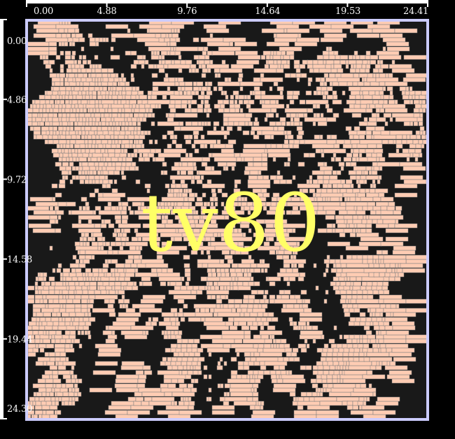

*ASAP7 TV80 at the end of `asap7_tv80_ipo.tcl`, in the GUI layout view.*

Outputs go to `results/sta_asap7_tv80_ipo/` and `results/sta_sky130_tv80_ipo/`. Native
outputs include `opt_progress.csv`, `tv80.changelist`, and `tv80.def`. The Tcl also saves
`design.v`, `design.def`, and `complete.txt` after the final reports. Failed runs can
leave partial native files. Treat a missing completion file as an unfinished run.

The native command invokes `plot_optimisation_progress.py` and
`compute_def_displacement.py` by filename. Both are included beside the Tcl scripts.
They provide the native progress figure and mean cell displacement, respectively;
they do not launch another EDA flow. A completed run's progress figure also appears in
the usual gallery after `python3 scripts/plot_results.py`.

The input mappings, DEFs and layer RC values come from the supplied TV80 examples.
The ASAP7 demonstration explicitly uses a 1.5 ns constraint, expressed as 1,500 ps,
to exercise timing optimisation. The original literal `3.0` would mean 3 ps with this
ASAP7 library. SKY130 retains its original 3 ns constraint. The two mappings and
constraints are separate examples, not a PDK performance comparison. Neither selector
changes them.

## 8. Analyse SET propagation

Follow a single-event transient (SET) from a struck combinational output through the
circuit and inspect where it arrives.

Open [SET/set_analysis.tcl](SET/set_analysis.tcl). Read the analysis in this order:

1. `report_timing` backannotates both maximum and minimum timing. The capture
   analysis needs setup and hold information.
2. `set_static_probability -value 0.5 -startpoints` initialises the startpoints.
   The following loop also sets P(1)=0.5 at register outputs.
   `annotate_static_probabilities` propagates those probabilities.
3. `create_particle_profile` defines the injected current pulse. The supplied
   DEXP profile uses 34 fC charge, 1 ps delay, and time constants of 10 and 100 ps.
4. `perform_exhaustive_SET_analysis` generates strikes at the combinational
   output sites and propagates their effects through the circuit.
5. The script exports the per-pin measurements, pulses, and analysed design.

Run the ASAP7 example:

```bash
python3 scripts/select_pdk.py ASAP7
python3 scripts/select_design.py counter
../Tool/build/refEDA -no_gui -f SET/set_analysis.tcl
python3 scripts/plot_results.py
```

Read the scenario and sensitivity reports. The two quantities used throughout the
reliability exercises are:

| Quantity | How to read it |
|---|---|
| ASET | Accumulated SET arrival sensitivity at a pin |
| LASET | Arrival sensitivity weighted by the tool's timing-window capture model |

These are accumulated quantities over the analysed scenarios. They can exceed one and
are not calibrated radiation-induced upset rates. Static probabilities use the tool's
gatewise 0-Algorithm; they do not fully represent arbitrary reconvergent correlations.

Open `set_counter_risk_map` in the gallery when using `counter`. Each cell is coloured
by the largest ASET among its pins. Locate the labelled high-sensitivity cells. Cream
means a measured zero; gray means the cell is outside the mapped measurements. The
square-root colour scale makes smaller nonzero values visible.

Check the result: `results/set_analysis/` contains `gatepins.csv`, `capture_pins.txt`,
`design.v`, and `design.def`. The `waveforms/` directory holds native pulse exports, and
`pwl/` holds sampled pulse files.

To try another injected charge, edit `set charge_fc 34` near the top of the Tcl file,
run the example again, and regenerate the figures. The new run replaces this example's
previous results. Keep the other settings fixed if you want to study the effect of
charge.

### Compare glitch propagation with Spectre

[`SET/set_vs_spice.tcl`](SET/set_vs_spice.tcl) checks the glitch propagation against a
transistor-level simulation. It strikes one cell output with an 80 fC double-exponential
pulse, lets refEDA generate the glitch and propagate it, then simulates the same circuit with
the same glitch waveform in Spectre and compares the two pin by pin
(`compare_SET_scenario_propagation_against_spectre`).

The circuit is the 21-buffer chain from the STA–SPICE exercise, struck at the output of the
first buffer, so the glitch can be followed through every stage to the output. Set `SET_PIN`
to strike another buffer output. Spectre must be on `PATH` with a valid licence.

```bash
../Tool/build/refEDA -no_gui -f SET/set_vs_spice.tcl
SET_PIN=bf_chain/U10/Y ../Tool/build/refEDA -no_gui -f SET/set_vs_spice.tcl
```

The run takes about 25 s. Read `results/set_vs_spice/set_vs_spice.csv`: one row per pin, with
the arrival time and slew of the glitch's rising and falling edges and its width, from refEDA
and from Spectre, and the difference in percent. `pwl/SET_0.pwl` is the generated glitch and
`SET_0.sp` the Spectre deck.

On the buffer chain both glitch edges arrive within about 1% of Spectre at every stage, and
the glitch width stays within 2.2%; refEDA's width grows slightly faster than Spectre's along
the chain. The largest difference is the falling-edge slew at the last buffer (−33%), which
drives the 5 fF output load.

The comparison needs `report_timing` before `set_static_probability`: without it this build
crashes in `set_startpoints_logic_one_probability`. On other circuits the command runs, but
on `c499` it compared only the three receivers of the struck gate, so the buffer chain is the
clearer example.

### Compare SET generation with Xyce

[`SET/set_xyce_bias.tcl`](SET/set_xyce_bias.tcl) checks the generated pulses, rather than
their propagation, against the open source circuit simulator Xyce. It runs the exhaustive
SET analysis three times with the same particle profile (34 fC, bias-dependent source):

1. `BIAS`: refEDA's internal bias-dependent model, solved by the tool's own engine.
2. `XYCE_ANALOG`: one SPICE deck per strike with the tool's analog equivalent model of the
   struck driver and its RC net, simulated in Xyce. It needs no transistor models.
3. `XYCE_TRANSISTOR`: one SPICE deck per strike with the struck cell and its receivers as
   transistor subcircuits, simulated in Xyce. The decks use the Xyce versions of the ASAP7
   files, `PDK/ASAP7/models/7nm_TT_xyce.pm` and
   `PDK/ASAP7/asap7sc7p5t_28/CDL/xAct3D_extracted/asap7sc7p5t_28_R_xyce.sp`.

Xyce must be on `PATH`; see [Set up Xyce](#set-up-xyce). Choose the design with
`SET_DESIGN`: `counter` (default), `gcd`, `uart` or `mac`. Every combinational output is
one Xyce run per Xyce model, so the larger designs are not offered.

```bash
../Tool/build/refEDA -no_gui -f SET/set_xyce_bias.tcl
SET_DESIGN=uart ../Tool/build/refEDA -no_gui -f SET/set_xyce_bias.tcl
```

Different designs can run at the same time. Read `results/set_xyce_bias_<design>/`:

| File | Content |
|---|---|
| `generation_statistics_<model>.csv` | One row per strike: amplitude, arrival times, width and slews of the generated pulse |
| `gatepins_<model>.csv` | Per-pin ASET, LASET and pulse measurements |
| `<model>.txt` | Sensitivity reports and the analysis runtime (`Analysis seconds`) |
| `xyce/` | The Xyce deck (`.sp`), measurements (`.mt0`), waveform (`.prn`) and log of every strike, `_analog_xyce` and `_transistor_xyce` |

`<model>` is `BIAS`, `XYCE_ANALOG` or `XYCE_TRANSISTOR`.

- **Accuracy:** compare the statistics files row by row (same scenario, same driver).
  `BIAS` against `XYCE_ANALOG` shows how closely the internal engine solves its own
  equivalent model; `BIAS` against `XYCE_TRANSISTOR` shows how well that model matches the
  transistor-level cells, for example on cells with an internal stage, such as AND2,
  whose internal node only the transistor-level deck models.
- **Speed-up:** compare `Analysis seconds` in `BIAS.txt` with `XYCE_ANALOG.txt` and
  `XYCE_TRANSISTOR.txt`.

`SET/set_spectre_bias.tcl` compares `BIAS` with `SPECTRE_TRANSISTOR` in the same way on
`counter`; it needs Spectre on `PATH` with a valid licence.


## 9. Measure the effect of SET mitigation

Determine whether a gate-sizing change improves capture sensitivity, and measure the
area cost.

Open [SET/set_mitigation.tcl](SET/set_mitigation.tcl). It performs two analyses in one
process: one before resizing and one afterwards, with the same particle profile and
probability assumptions.

With ASAP7, the script selects up to 32 `NAND2xp33` or `NAND2xp5` instances in sorted
name order and replaces them with `NAND2x2`. This increases drive strength and cell
area. It then legalises, refreshes maximum/minimum timing, resets and recomputes static
probabilities, and repeats the exhaustive analysis.

Run the ASAP7 example:

```bash
python3 scripts/select_pdk.py ASAP7
python3 scripts/select_design.py counter
../Tool/build/refEDA -no_gui -f SET/set_mitigation.tcl
python3 scripts/plot_results.py
```

Find the `Resizing` line in the output to see how many cells were eligible. Read the
`Before` and `After` sensitivity and area reports.

Open `set_mitigation_register_changes` in the gallery:

- Each bar is **LASET after − LASET before** at one register data input.
  Blue means lower capture sensitivity; orange means higher sensitivity.
- The placement panel highlights the cells that were resized.
- The title gives the area change and the change in summed register-input LASET.

Upsizing changes loading and pulse propagation, so an area increase does not guarantee a
reliability improvement. The cell selection demonstrates the ECO flow; it does not rank
cells by sensitivity. If the LASET sum increases, report that the chosen resizing made
this measurement worse under these conditions.

Check the result: `results/set_mitigation/` contains `before.txt`, `after.txt`,
`gatepins_before.csv`, `gatepins_after.csv`, `before.def`, and the resulting
`design.v`/`design.def`. Use the paired measurements from this exercise for the
comparison; it does not depend on exercise 8's results.

### Optional: ML SET generation models

`SET/set_generation_models.tcl` compares the bias-dependent and ML generation models, and
`SET/set_ipo.tcl` uses the ML model to choose SET-hardening moves. The ML model and the
Python it runs on come with refEDA (`../Tool/build`), so no Python packages or other setup
are needed:

```bash
../Tool/build/refEDA -no_gui -f SET/set_generation_models.tcl
../Tool/build/refEDA -no_gui -f SET/set_ipo.tcl
```

Check that the log reports generated pulses, such as `Generated SET pulses: 198` (once for
`BIAS` and once for `ML` in `set_generation_models.tcl`).

## 10. Analyse SEU propagation and harden registers with TMR

A single event upset (SEU) is a bit flip in a register. Find which registers spread a
flip most widely, then protect the most critical ones with triple modular redundancy
(TMR).

Both scripts use the ISPD 2012 `pci_bridge32`: an OpenCores PCI bridge with 25,310
cells and 3,359 registers, placed in ASAP7 4× geometry. The design and its 660 ps clock
are fixed in the scripts.

The analysis computes P, the probability that a flip in one register reaches an
endpoint (a primary output or a register data pin) in the same clock cycle. It uses
binary decision diagrams (BDDs), so P is exact. Each register then gets these values:

- AcPP: the sum of P over the endpoints it reaches.
- Criticality: p × AcPP, where p is the SEU probability of the register (1 here).
- Design AcPP: the sum of the criticalities of all registers.

[SEU/seu_analysis.tcl](SEU/seu_analysis.tcl) runs the analysis and the reports:

1. `inject_SEU -all` creates one SEU scenario per register output.
2. `set_static_probability -startpoints` sets P(1) = 0.5 at the primary inputs and
   register outputs, the inputs of the logic cones.
3. `set_SEU_BDD_limits` bounds the BDD work per endpoint, and
   `set_SEU_analysis_workers 4` runs the analysis in four processes.
4. `perform_SEU_analysis -exhaustive` computes P for every register–endpoint pair.
5. `report_SEU_analysis_measurements`, `report_SEU_top_flip_flops` and
   `report_SEU_top_endpoints` rank the registers and endpoints;
   `dump_SEU_analysis_metrics` writes every value to CSV.

[SEU/seu_tmr.tcl](SEU/seu_tmr.tcl) repeats the analysis, then runs
`eco_perform_SEU_TMR_hardening`. The flow triplicates registers from the most critical
down: two replicas and a majority voter each. A flip in one copy is out-voted, so the
flow subtracts that register's criticality from the design AcPP without a new analysis.
It stops when half of the design AcPP is removed (`-target_reduction 0.5`). It then
legalises the new cells and updates the timing.

Run the two examples:

```bash
../Tool/build/refEDA -no_gui -f SEU/seu_analysis.tcl
../Tool/build/refEDA -no_gui -f SEU/seu_tmr.tcl
```

Check the analysis in `results/seu_analysis/result.txt`. The method table should list
all 80,014 register–endpoint pairs as computed with BDDs and none as not computed. The
hardening curve shows that the top 886 registers (26%) hold half of the design AcPP. The
most critical registers are request flags of the PCI initiator and the write enable and
write pointers of the PCI target FIFOs.

Check the hardening in `results/seu_tmr/result.txt`:

- **Stop reason:** E1, target reduction reached.
- **Hardened:** 886 registers, removing 50% of the design AcPP.
- **Area:** about 33% cell-area overhead.
- **Timing:** WNS stays positive.
- **Placement:** legal.

`<prefix>_SEU_TMR_steps.csv` records every step of the flow.

The analysis models one flip at a time and only its propagation within one cycle. It
does not include electrical or timing masking. An endpoint whose BDD exceeds a limit is
skipped and its pairs count as P = 0; the analysis then prints a warning and the report
counts the pairs as not computed. These examples produce no figures: read the reports
and CSV files directly.

## 11. Inject particle hits (SEMT analysis)

The SET exercises 8 and 9 strike one cell output at a time. A real particle hits a point of the
layout, and its charge can reach several neighbouring cells at once. Each struck cell then
starts its own transient: a single-event multiple transient (SEMT). The SEMT scripts model
this on the placed `counter`: they inject particle hits at random positions in a grid over
the layout, find which cells each hit reaches, share the hit's charge among them, then
generate and propagate all the resulting transients and measure which registers latch them.

### SEMT scripts

| Script | What it does | Run time |
|---|---|---|
| [`semt_injection.tcl`](SEMT/semt_injection.tcl) | 100 hits in each of 4 × 4 grids; failure probability per grid, per LET range and for the design | about 20 s |
| [`semt_sfi.tcl`](SEMT/semt_sfi.tcl) | Statistical fault injection: adds hits until the failure probability per hit is known within ±0.01 at 95% confidence | about 25 s |
| [`semt_ipo.tcl`](SEMT/semt_ipo.tcl) | The same hits before and after the SET IPO of exercise 9, to see what the IPO does to multiple transients | about 25 s |

All three use the ML pulse generation model of [the ML section](#optional-ml-set-generation-models),
which comes with refEDA. Set `model` to `DEXP` or `BIAS` at the top of a script to use
another generation model. The design and PDK are fixed:
ASAP7 `counter` with 4× geometry, which `asap7_R_4x_SET_collector_lengths.tcl` matches.

```bash
../Tool/build/refEDA -no_gui -f SEMT/semt_injection.tcl
../Tool/build/refEDA -no_gui -f SEMT/semt_sfi.tcl
../Tool/build/refEDA -no_gui -f SEMT/semt_ipo.tcl
```

Each hit gets a random position in its grid, a random LET between 0.5 and 60 MeV cm²/mg (its
charge follows from the LET) and an affected area that grows with the LET. A hit that reaches
no cell is a miss, one that reaches a single cell is a SET, and one that reaches two or more
cells is an SEMT. The measurements, per grid and for the design, are:

| Quantity | Meaning |
|---|---|
| RP | Reach probability: a transient arrives at a register input |
| FP | Failure probability: at least one register latches it |
| LE | Latching efficiency, FP / RP |
| XS | Cross section: the layout area that fails per hit, in µm² |

In `semt_injection.tcl`, 181 of the 1,600 hits miss, 141 are SETs and 1,278 are SEMTs: on a
dense layout most hits reach more than one cell. The design FP per hit is 0.364 (95%
confidence interval ±0.016), 0.28 for SET hits and 0.42 for SEMT hits. The cross section grows
with the LET, from 92 µm² below 10 MeV cm²/mg to 462 µm² above 49.

### The SEMT graphs in the GUI

Run the scripts without `-no_gui` (with `refEDA_INSTALL_DIR` set, see
[Watch an exercise in the GUI](#watch-an-exercise-in-the-gui)). At the end each script draws
three heatmaps over the layout, one after the other, and saves each as a vector PDF:
`grids_FP.pdf`, `grids_affected_gates.pdf` and `grids_semts.pdf` in its results folder. With
`-no_gui` the PDFs are still written; only the live view is missing.

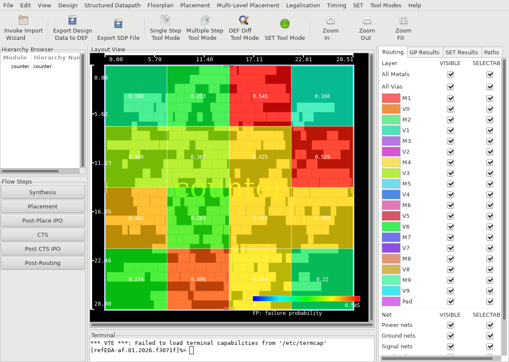

*The failure probability per grid, drawn over the placed `counter` in the GUI after
`semt_injection.tcl`. Grids range from 0.17 to 0.55: the corners, with few cells, fail least.*

`particle_hits_injection -svg` also writes plots of every hit next to `particle_hits.log`:
`hits.svg` (all hits, coloured miss, SET or SEMT), `hits_misses.svg`, `hits_sets.svg`,
`hits_semts.svg`, `hits_radius.svg` (each hit with its affected area) and `heatmap.svg`
(affected gates and SEMT hits per grid). Open them in a browser.

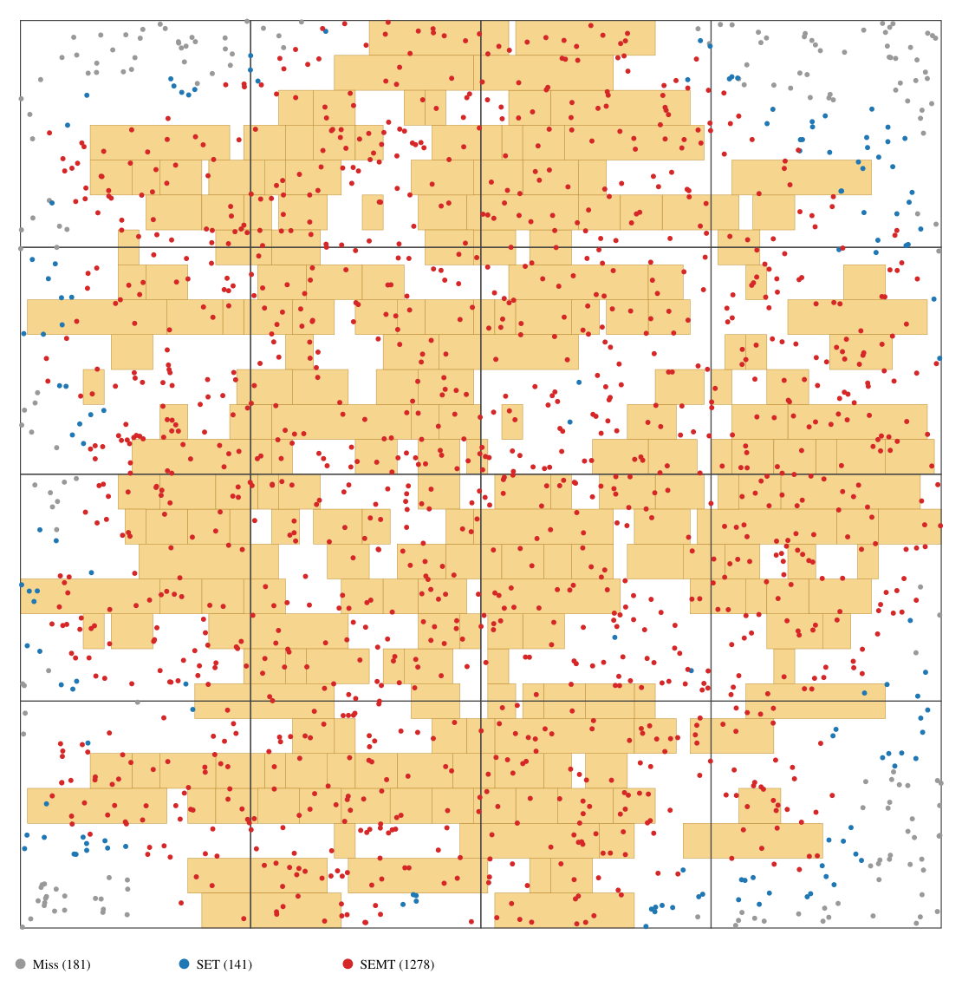

*All 1,600 hits of `semt_injection.tcl` over the placed cells: grey misses, blue SETs, red
SEMTs. Misses and SETs gather at the sparse edges and corners.*

### Statistical fault injection

A fixed number of hits gives an estimate with an uncertainty. `semt_sfi.tcl` adds hits to every
grid in iterations, and stops when the 95% confidence interval of the mean FP per hit is within
±0.01 (the E-P algorithm of Ruospo et al., IEEE Transactions on Computers, 2025). Here it needs
three iterations: 400 hits (FP 0.365 ± 0.032), 3,648 hits (0.371 ± 0.011) and 4,256 hits
(0.374 ± 0.010). `sfi_iterations.csv` lists each iteration.

### SEMT before and after the SET IPO

`semt_ipo.tcl` injects the same hits (same seed) into the original layout and into the layout
optimised by the SET IPO of exercise 9. The IPO optimises against one 34 fC single-cell strike:
it reduces the latched sensitivity (LASET) of that strike by 18% for 10.3% more area. Under the
random particle hits, the design FP per hit goes from 0.364 to 0.396: unchanged for SET hits
(0.284 to 0.282) but up for SEMT hits (0.424 to 0.463), and the cross section grows from 291 to
317 µm². An optimisation is only as good as the fault model it optimises against.

Check the results: `results/semt_injection/`, `results/semt_sfi/` and `results/semt_ipo/` each
contain `result.txt`, the CSV files named in the script, `design.def` and the grid PDFs.

## 12. Analyse an asynchronous circuit with ASTA

Find the event cycle that limits the circuit and inspect the timing of any datapath
driven by its controllers.

Each ASTA Tcl has a fixed circuit. Choose the circuit by its script filename.
`select_pdk.py` can switch its cell mapping between ASAP7 and IHP Open PDK;
`select_design.py` leaves it unchanged.

A Click controller uses request and acknowledgement signals to generate a local clock.
The bundled-data designs use those clocks to drive datapath registers. Where a design
has separate controller modules, `set_async_modules` identifies them. Each script uses
`extract_eventgraph` to build the event graph in memory, then `report_timing -async
-longest -corner 0` to analyse it. The critical-cycle report lists the events and delays
that determine the reported cycle period.

### ASTA scripts

| Script | Circuit and what to inspect |
|---|---|
| [`ring_enable.tcl`](Asynchronous/ASTA/ring_enable.tcl) | Enable a three-gate oscillator with `set_case_analysis 1 EN`. Trace rising and falling events through the NAND gate and two inverters. |
| [`click_scan.tcl`](Asynchronous/ASTA/click_scan.tcl) | Set `test_se=0` on a single scan-capable Click stage to select its functional clock and data paths. Trace the cycle through the handshake logic and toggle flip-flop. |
| [`click_control_ring.tcl`](Asynchronous/ASTA/click_control_ring.tcl) | Trace request and acknowledgement events across two Click controllers before placement. This controller-only netlist is also the input to [Click ring optimisation](Asynchronous/AIPO/optimise_placed_click_ring.tcl). |
| [`click_bundled_data.tcl`](Asynchronous/ASTA/click_bundled_data.tcl) | Analyse two Click controllers driving a small datapath. Read the critical cycle, controller-derived clocks, and datapath setup slack. This script saves the cycle report for plotting. |
| [`click_datapath_fanout.tcl`](Asynchronous/ASTA/click_datapath_fanout.tcl) | Analyse a Click ring whose first-stage clock drives a buffered register bank. Read the derived clocks and setup slack, then check the two relative-timing bounds. |

Run each script in a fresh refEDA process from the tutorial root:

```bash
../Tool/build/refEDA -no_gui -f Asynchronous/ASTA/ring_enable.tcl
../Tool/build/refEDA -no_gui -f Asynchronous/ASTA/click_scan.tcl
../Tool/build/refEDA -no_gui -f Asynchronous/ASTA/click_control_ring.tcl
../Tool/build/refEDA -no_gui -f Asynchronous/ASTA/click_bundled_data.tcl
../Tool/build/refEDA -no_gui -f Asynchronous/ASTA/click_datapath_fanout.tcl
```

In the register-bank example, `set_RT_path` traces the primary path from `click1/Rin` to
the first datapath register's clock pin and the reference path from `click2/ff/Q` to the
first controller's clock pin. The two illustrative constraints require the primary path
to take between 30 and 80 ps longer than the reference. The literal `set_RT_constraint`
margins are 0.030 and 0.080 in the native ns timing scale and remain the same when
changing PDKs. Read `report_RT_violations` separately from the datapath setup report.

To plot the cycle from `click_bundled_data.tcl`, run `python3 scripts/plot_results.py`
and open `asta_critical_cycle`. Nodes are cell-output events, arrows show stage delays,
and orange marks the largest contributions. The centre shows the critical-cycle period.
The saved measurement is in `results/asta/result.txt`.

## 13. Optimise an asynchronous circuit with AIPO

Inspect how asynchronous optimisation changes a placed control cycle.

Each AIPO Tcl has a fixed circuit. Choose the circuit by its script filename.
All nine support ASAP7 and IHP Open PDK through `select_pdk.py`.
`select_design.py` leaves every AIPO circuit unchanged.

| Script | Circuit and purpose |
|---|---|
| [`optimise_placed_click_ring.tcl`](Asynchronous/AIPO/optimise_placed_click_ring.tcl) | Place a two-stage Click ring, then compare its critical cycle before and after ten ECO iterations. Start here to follow a short cycle gate by gate. |
| [`aipo_ring_enable.tcl`](Asynchronous/AIPO/aipo_ring_enable.tcl) | Measure a three-gate enabled oscillator before placement, after placement, and after one ECO iteration. This is the smallest example. |
| [`optimise_placed_mr0.tcl`](Asynchronous/AIPO/optimise_placed_mr0.tcl) | Place a master-read controller with multiple feedback paths and run ten ECO iterations. Compare its reported cycle period and cell area at all three stages. |
| [`optimise_placed_click_three_stage.tcl`](Asynchronous/AIPO/optimise_placed_click_three_stage.tcl) | Place a three-stage Click ring with reset/preset state and a datapath, then optimise its control cycle. |
| [`optimise_placed_pausible_clock.tcl`](Asynchronous/AIPO/optimise_placed_pausible_clock.tcl) | Measure an eight-bit pausible-clock timing example before placement, after placement, and after one ECO iteration. |
| [`optimise_placed_cla_adder.tcl`](Asynchronous/AIPO/optimise_placed_cla_adder.tcl) | Place a 32-bit asynchronous carry-lookahead adder with two control stages, then optimise the critical control cycle. |
| [`optimise_placed_alu_pipeline.tcl`](Asynchronous/AIPO/optimise_placed_alu_pipeline.tcl) | Place an asynchronous pipeline with four-bit operands and a seven-bit operator input, then optimise its critical control cycle. |
| [`optimise_placed_bundled_data_token.tcl`](Asynchronous/AIPO/optimise_placed_bundled_data_token.tcl) | Place a token-initialised bundled-data controller with a scan-programmable delay path, then optimise the control cycle. |
| [`optimise_placed_send_controller.tcl`](Asynchronous/AIPO/optimise_placed_send_controller.tcl) | Place a two-state SEND controller with a scan-programmable delay path, then optimise the control cycle. |

All nine scripts start from mapped Verilog, create their own floorplan, and use the
selected PDK. No earlier placement run is required.

### Optimise the Click control ring

[`optimise_placed_click_ring.tcl`](Asynchronous/AIPO/optimise_placed_click_ring.tcl) optimises the
same 14-cell netlist that `click_control_ring.tcl` analyses before placement. Both
scripts load their own input files. Compare the two placed measurements within the AIPO
run to assess the ECO.

The script creates a floorplan at 45% utilisation, places and legalises the circuit, and
reports its initial critical cycle. It then calls `eco_optimise_design -async
-iterations 10`, legalises again, and reports the result. It uses estimated lumped wire
RC on M3 for ASAP7 or Metal3 for SG13G2.

Run:

```bash
../Tool/build/refEDA -no_gui -f Asynchronous/AIPO/optimise_placed_click_ring.tcl
python3 scripts/plot_results.py
```

Open `aipo_critical_cycle`:

- The centre shows the control-cycle period before and after optimisation.
- Blue arrows indicate lower stage delay; orange indicates higher delay.
- Purple outlines identify resized gates. A changed cycle can contain arcs
  with no earlier match; those are labelled `new arc`.

Check the result: `results/aipo/` contains the before/after reports, `before.def`, and
the resulting `design.v`/`design.def`. Check the final placement-legality report as well
as the period. A smaller period indicates a faster reported control cycle under this
example's model.

The placed ring is small enough to read every instance name in the GUI: the two
flip-flops `click1/ff` and `click2/ff`, and the XNOR and NAND gates of each Click stage.
Use these names to find the gates that `aipo_critical_cycle` marks as resized.

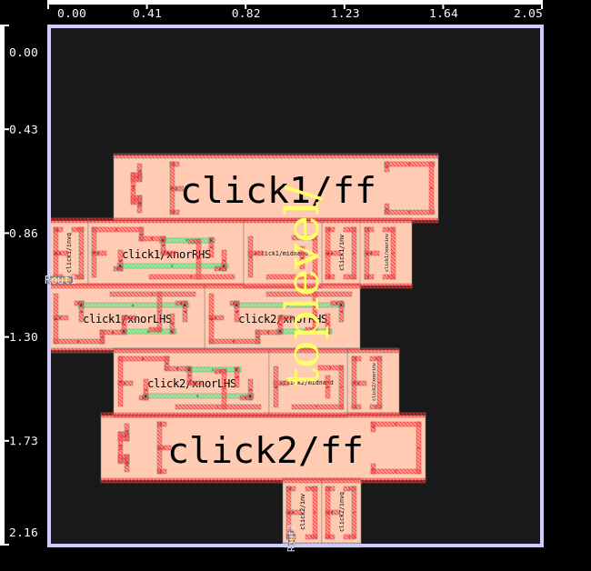

*The Click control ring at the end of `optimise_placed_click_ring.tcl`, in the GUI.*

### Optimise the enabled ring

[`aipo_ring_enable.tcl`](Asynchronous/AIPO/aipo_ring_enable.tcl) places and optimises the oscillator
from `ring_enable.tcl`. It reports the period at three points.

```bash
../Tool/build/refEDA -no_gui -f Asynchronous/AIPO/aipo_ring_enable.tcl
```

1. **Before placement.** Measure the cycle with cell delays.
2. **After placement, before optimisation.** Build and legalise a placement,
   then measure again with estimated wire RC.
3. **After optimisation.** Run one asynchronous ECO iteration, legalise the
   placement again, and report the resulting period.

Use the last two periods to judge the ECO under the placed timing model. The small ring
can finish with zero accepted moves and an unchanged period. Check the move summary and
final legality report, then find `design.v` and `design.def` in
`results/aipo_ring_enable/`.

### Optimise the MR0 master-read controller

[`optimise_placed_mr0.tcl`](Asynchronous/AIPO/optimise_placed_mr0.tcl) runs the MR0 master-read
controller. Its top module is `master_read0_net`, with five inputs and nine outputs.
State is held in gate feedback rather than flip-flops. It has 56 cells in ASAP7 and 60
cells in IHP-Open-PDK.

Run it directly, then generate the figures:

```bash
../Tool/build/refEDA -no_gui -f Asynchronous/AIPO/optimise_placed_mr0.tcl
python3 scripts/plot_results.py
```

The script performs these steps:

1. Load the libraries and mapped MR0 netlist. Use NLDM timing and a 5 fF load
   on each output, expressed as 0.005 pF when IHP-Open-PDK is selected.
2. Extract the event graph and report the critical cycle, period, and cell
   area before placement. No wire RC is enabled at this stage.
3. Enable estimated lumped wire RC, create a square floorplan at 45%
   utilisation, place the I/Os, run global placement with solver 3 and
   gradient 3, and legalise the cells.
4. Extract the event graph again and record the placed baseline. Save its
   cell types and positions in `before.def`.
5. Run `eco_optimise_design -async -iterations 10`, legalise again, and
   report the resulting cycle, cell area, and placement legality.
6. Export the final mapped netlist and DEF.

Check the result: `results/aipo_mr0/` contains `unplaced.txt`, `before.txt`,
`after.txt`, `before.def`, `design.v`, and `design.def`. Terminal output stays visible.
Open `aipo_mr0_timing_area` in the gallery to see the three periods and cell areas.
Judge the ECO using the placed baseline and final result; the unplaced measurement shows
the earlier cell-delay estimate.

The two mappings preserve the controller's gate equations. In SG13G2, three OAI211 gates
and one AOI31 gate each become two cells, accounting for the four extra cells. The
reported timing belongs to the selected mapped circuit and the loading defined here.

The current build emits `Path Endpoint Gatepin ... NOT Matched to Event` warnings on
this controller's branched feedback paths. Check these alongside the reported critical
cycle. A completed run and legal placement demonstrate the flow; the cycle report does
not establish protocol correctness or hazard-free operation.

The GUI shows the placed controller at the end of the script, with its five inputs and
nine outputs on the left and right edges of the core:

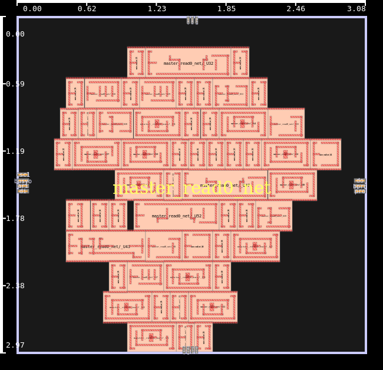

*`master_read0_net` (ASAP7) at the end of `optimise_placed_mr0.tcl`, in the GUI.*

### Controller and arithmetic circuits

These six scripts run the same sequence on different circuits. Each starts from its own
mapped Verilog, uses NLDM and a 5 fF output load, reports the unplaced cycle, and
creates a square floorplan at 45% utilisation. It then places the I/Os, runs global
placement with solver 3 and gradient 3, legalises, and records the placed baseline. ECO
is followed by another legalisation, final reports, and Verilog/DEF exports.

The default budget is ten ECO iterations. The pausible-clock example uses one iteration:
longer runs reached a `clear_cellpool` crash in this build after convergence. Keep that
one-iteration budget with either PDK.

| Circuit | Top module | ASAP7 cells | IHP-Open-PDK cells | Registers |
|---|---|---:|---:|---:|
| `click_three_stage` | `toplevel` | 43 | 35 | 6 |
| `pausible_clock` | `SynchronizerToolkitPausibleClk` | 131 | 59 | 18 |
| `cla_adder` | `cla_adder_async` | 633 | 489 | 98 |
| `alu_pipeline` | `alu_pipe_async` | 114 | 94 | 21 |
| `bundled_data_token` | `bd_flop_ctrl_tok` | 88 | 88 | 4 |
| `send_controller` | `SEND_ctrl_slackless` | 104 | 92 | 5 |

Cell counts describe the supplied mapped inputs, including tie cells. They count
physical standard cells and exclude hierarchical module instances. The two PDKs use
different cell decompositions.

Run any example directly from the tutorial directory:

```bash
../Tool/build/refEDA -no_gui -f Asynchronous/AIPO/optimise_placed_click_three_stage.tcl
../Tool/build/refEDA -no_gui -f Asynchronous/AIPO/optimise_placed_pausible_clock.tcl
../Tool/build/refEDA -no_gui -f Asynchronous/AIPO/optimise_placed_cla_adder.tcl
../Tool/build/refEDA -no_gui -f Asynchronous/AIPO/optimise_placed_alu_pipeline.tcl
../Tool/build/refEDA -no_gui -f Asynchronous/AIPO/optimise_placed_bundled_data_token.tcl
../Tool/build/refEDA -no_gui -f Asynchronous/AIPO/optimise_placed_send_controller.tcl
python3 scripts/plot_results.py
```

Each command runs independently. To use IHP-Open-PDK, run `python3 scripts/select_pdk.py
IHP-Open-PDK` first; switch back with `python3 scripts/select_pdk.py ASAP7`.

#### Three-stage Click ring

`optimise_placed_click_three_stage.tcl` declares `click1`, `click2`, and `click3` as
asynchronous modules. Two controller state flops clear when `rst` is low; the third
presets, supplying the initial token. The datapath contains three further resettable
registers. Follow the reported cycle across the three controllers and inspect which
gates ECO resizes.

#### Pausible-clock example

`optimise_placed_pausible_clock.tcl` analyses the flattened
`SynchronizerToolkitPausibleClk` module, containing the controller and an eight-bit
datapath with two register banks. `arst` is inverted before the controller's
request-register reset. The inherited `scanCk` and `scanTest` ports are unused, and the
mapped scan selects remain tied low.

The supplied netlist connected both the acknowledgement FF and an inverter to `ack`,
while the inverter input `n5` was undriven. This adaptation connects the FF output to
`n5`, leaving the inverter as the sole `ack` driver. Flattening the netlist avoids a
hierarchical Verilog-export crash observed in this build. The supplied output inversions
and NAND replacements for the mutex and C-element are retained. Use this circuit to
demonstrate timing and ECO; its structure does not establish mutual exclusion or
metastability safety.

#### Carry-lookahead adder

`optimise_placed_cla_adder.tcl` uses the supplied 32-bit adder with 98 registers,
including its two controller state registers. Its asynchronous module list follows the
supplied control, flop, and delay-line modules. The critical-cycle report describes the
control loop. Remapping the delay line changes its timing; compare the placed and
optimised control-cycle periods without interpreting them as proof that every data path
settles before capture.

#### ALU pipeline

`optimise_placed_alu_pipeline.tcl` uses four-bit operands, a seven-bit operator input,
and a four-bit result. The circuit contains 21 registers, including two controller state
registers. It uses the supplied asynchronous module list and the same placement/ECO
sequence as the adder. Inspect the control-cycle period and area after ECO; the example
does not add new relative-timing constraints for the arithmetic datapath.

#### Bundled-data token controller

`optimise_placed_bundled_data_token.tcl` retains the supplied `bd_flop_ctrl_tok`
controller, its preset state register, clock mux, and three-bit scan-programmed delay
selector. The selector contains two reset flops and one preset flop. Preserve the
supplied scan and reset connections when inspecting the circuit; the Tcl script analyses
the mapped event graph without applying a scan-programming stimulus.

#### SEND controller

`optimise_placed_send_controller.tcl` retains the supplied `SEND_ctrl_slackless`
topology, two controller state registers, two clock muxes, and the same three-bit
programmable delay structure. It measures the critical cycle of the remapped circuit.
The inherited module name does not certify that the new mapping satisfies the original
timing relationships.

#### Mapping and results

All required netlists are under `Test-Designs/Asynchronous/` and
`Test-Designs/IHP-Open-PDK/`. Only the bundled open PDKs are loaded. Gate functions were
checked exhaustively against the supplied cells. Positive-edge clocking, active-low
reset/preset behavior, and scan data selection are preserved. ASAP7 reset/preset flops
use their complemented output followed by an inverter. IHP preset flops use a reset flop
with inverted data and output, preserving the state polarity without requiring a
dedicated preset cell.

Explicit delay cells become fixed buffer chains: the supplied 40/60/100 delay variants
use 2/3/5 buffers respectively, and the supplied delay-1/delay-2 variants use 2/4
buffers. Ordinary buffers remain single buffers. These choices preserve non-inverting
logic and delay-chain ordering; the original absolute delays, drive strengths, and
process-specific performance are not reproduced.

For each circuit, find its outputs in `results/aipo_<circuit>/`:

- `unplaced.txt`: critical cycle, period, and area before placement.
- `before.txt`: the placed baseline used to assess ECO.
- `after.txt`: final critical cycle, period, area, and legality report.
- `before.def`: baseline cell types and positions.
- `design.v` and `design.def`: final circuit and placement.
- `info.txt`: circuit name, PDK, and completion marker.

The gallery creates `aipo_<circuit>_timing_area` as PNG and PDF. Use the **Placed** and
**After ECO** bars to assess optimisation; **Unplaced** shows the earlier estimate
without wire RC. The output folders are independent and are replaced on rerun.
Event-matching warnings remain visible in the terminal. For each run, check the final
legality report, completion marker, and exported files. The cycle measurements quantify
this timing model. Protocol behaviour and relative-timing requirements need their own
checks.

## 14. Run global placement

Produce a legal cell placement and understand its wirelength and local density.

Open [Placement/global_placement.tcl](Placement/global_placement.tcl). The script loads
the selected netlist and DEF, including the floorplan and I/O locations. `global_place`
arranges the cells, and `legalise_components` removes overlaps and aligns cells with
placement rows and sites.

Run the ASAP7 example:

```bash
python3 scripts/select_pdk.py ASAP7
python3 scripts/select_design.py counter
../Tool/build/refEDA -no_gui -f Placement/global_placement.tcl
python3 scripts/plot_results.py
```

In the terminal, find the final HPWL, area, and placement-legality reports. HPWL is
half-perimeter wirelength: for each net, it adds the width and height of the bounding
box around its pins, then sums across nets. It is a placement wirelength estimate.

In the gallery, open `global-placement_layout_density`:

- The left panel shows final cell positions, coloured by cell type.
- The right panel divides the core into 10×10 bins and shows cell area divided
  by bin area. It helps you locate crowded regions.
- The title gives the final HPWL. The plot reports the resulting placement;
  there is no comparison against the loaded DEF.

Check the result: the terminal reports `Current Placement is legal.`, the script prints
`TUTORIAL_COMPLETE`, and `results/global_placement/design.def` exists. This DEF is the
placement produced by the exercise.

### Timing-driven global placement

These scripts run `global_place -timing_driven` from a mapped ASAP7 netlist, using CCS
timing and pi-model wire RC. They create their own 70% utilisation floorplan, so they
need no input DEF. They differ only in how slack maps to net weight:

| Script | Slack-to-weight mapping | Weight range |
|---|---|---|
| [`td_gp_linear.tcl`](Placement/td_gp_linear.tcl) | Linear | 0.4 to 10 |
| [`td_gp_exp.tcl`](Placement/td_gp_exp.tcl) | Exponential | 0.4 to 10 |
| [`td_gp_pwl.tcl`](Placement/td_gp_pwl.tcl) | Piecewise linear | 0.6 to 3 |

Choose the design with the selector, and the lowest routing metal with `TD_METAL`
(`M3` by default, or `M4`):

```bash
python3 scripts/select_design.py gcd
../Tool/build/refEDA -no_gui -f Placement/td_gp_linear.tcl
TD_METAL=M4 ../Tool/build/refEDA -no_gui -f Placement/td_gp_linear.tcl
```

Results are saved in `results/td_gp_<design>_<mapping>_<metal>/`, so runs on different
designs, mappings and metals do not replace each other. Compare WNS, TNS and HPWL in the
terminal or in `result.txt`. The output delay equals one clock period, so these
demonstration constraints leave paths to outputs with no margin. The M4 wire values are
scaled from the M3 estimate using the extraction rules in `PDK/ASAP7/rcx_patterns.rules`,
and are estimates rather than signed-off RC.

## 15. Run detailed placement

Refine cell positions with a local placement search.

Open [Placement/detail_placement.tcl](Placement/detail_placement.tcl). It first
legalises the selected input DEF, configures density and move-search controls, then
calls `detail_place -optmode 0 -approach 1`. The script uses a 6×6 density grid with a
target occupancy of 0.8 (80%) and allows up to 100 search iterations. The search enables
temporary bad moves and uses a 0.1 cost-improvement stopping threshold; these are search
controls, not a requirement that every run improve wirelength.

Run the ASAP7 example:

```bash
python3 scripts/select_pdk.py ASAP7
python3 scripts/select_design.py counter
../Tool/build/refEDA -no_gui -f Placement/detail_placement.tcl
python3 scripts/plot_results.py
```

Read the final HPWL, area, and legality reports. Then open
`detail-placement_layout_density` in the gallery and identify the most densely occupied
bins. The plot uses the same 10×10 display grid as exercise 14; this is separate from the
optimiser's 6×6 density constraints.

Check the result: placement is legal and the resulting DEF is saved in
`results/detail_placement/design.def`. With ASAP7 selected, this exercise loads its own
netlist/DEF pair from `Test-Designs/Synchronous/`. It runs independently of exercise 14.

In the GUI, compare the final rows with the density figure: the densest bins in the
gallery are the areas where the rows are filled end to end.

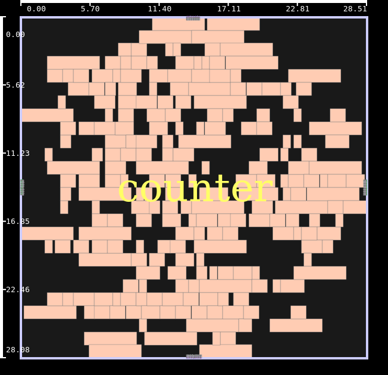

*`counter` (ASAP7) at the end of `Placement/detail_placement.tcl`, in the GUI layout view.*

## 16. Gate-level placement

Create the physical layout from a mapped gate-level netlist, starting without an input
DEF.

Open [Placement/gate-level-placement.tcl](Placement/gate-level-placement.tcl). It loads
the same LEF and Liberty libraries as the other placement examples, then loads
`Test-Designs/Synchronous/${design}.v`. The Verilog must already be mapped to the
selected PDK's standard cells. The script starts after synthesis.

Follow the physical-design steps in the Tcl file:

1. `initialise_floorplan -utilisation 50 -aspectratio 1` creates the floorplan
   and placement rows. Utilisation is a percentage: 50 leaves roughly half of
   the core area available for cell area, before row/site rounding. Aspect
   ratio 1 requests a square core.
2. `io_place` places the top-level I/O pins on the new floorplan.
3. `global_place` arranges the cells to optimise estimated wirelength.
4. `legalise_components` removes overlaps and aligns cells with rows and sites.
5. `detail_place` refines the placement with local moves. The final
   `legalise_components` call restores legal cell positions after the search.
6. Report final wirelength, area, placement legality, and setup/hold timing,
   then save the netlist and DEF.

Run the ASAP7 example from the tutorial root:

```bash
python3 scripts/select_pdk.py ASAP7
python3 scripts/select_design.py mac
../Tool/build/refEDA -no_gui -f Placement/gate-level-placement.tcl
python3 scripts/plot_results.py
```

Open `placement-from-verilog_layout_density` in the gallery. It shows the resulting cell
placement and a 10×10 density map, with final HPWL in the title. Exercise 14 explains how to read these panels.

The GUI shows the same final placement: the cells sit on the rows that
`initialise_floorplan` created, and the I/O pins (grey) on the core boundary.

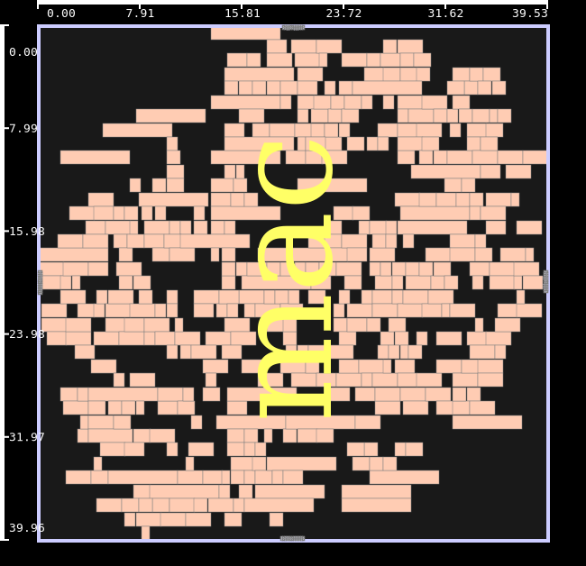

*`mac` at the end of `Placement/gate-level-placement.tcl`, in the GUI layout view.*

Check the result: the terminal reports `Current Placement is legal.` and
`TUTORIAL_COMPLETE`. The generated `design.v`, `design.def`, and final `result.txt` are
in `results/placement_from_verilog/`. No input DEF is loaded. The output is a placed
design; clock-tree synthesis and routing are not part of this example.

To try a denser floorplan, change `-utilisation 50` in this Tcl file and rerun. A higher
utilisation gives less space for placement. Read the final legality report and the
density figure to assess the result. Rerunning replaces this example's previous results.
`select_pdk.py` also sets Asynchronous/ASTA/AIPO to their ASAP7 mappings.
`select_design.py` configures the six placement/SET/RADHARD scripts and
the six STA–SPICE scripts.
Each following run block for those six scripts selects its circuit explicitly.

## 17. Separate redundant registers with RADHARD legalisation

Insert register redundancy and place the replicas far enough apart to satisfy a
minimum-spacing constraint.

Use the supplied `uart` setting in
[Radhard/radhard_legalisation.tcl](Radhard/radhard_legalisation.tcl). This circuit has
space for the tutorial's redundant cells; small designs can run out of core capacity
after insertion.

Follow these commands in the script:

1. `eco_tmr_component` adds two replicas and a majority voter for each selected
   register. The script selects up to 32 registers in sorted name order.
2. `create_rh_group` groups the original register with its two replicas.
3. `set_rh_group_spacing -min 20` requires separation within each group.
4. `legalise_RH_components` places the groups while enforcing that separation.
5. The spacing and placement reports check the result.

Run the ASAP7 example:

```bash
python3 scripts/select_pdk.py ASAP7
python3 scripts/select_design.py uart
../Tool/build/refEDA -no_gui -f Radhard/radhard_legalisation.tcl
python3 scripts/plot_results.py
```

The ASAP7 input layout uses 4× geometry. A spacing of 20 layout µm represents 5 µm at 1×
scale. The figures display the 1× distances.

Open `radhard_triplet_placement`. It shows the three groups with the smallest initial
spacing (ties use group index), after TMR insertion and after RH legalisation. Colours
identify the groups; labels give the reported minimum spacing. Lines connect cell
centres as visual guides. The spacing check itself uses the tool's geometric separation,
not the length of those centre-to-centre lines. All groups are checked, including those
not drawn in the figure.

Check the result: the final report gives zero RADHARD spacing violators and a legal
placement. `results/radhard_legalisation/groups.tsv` records every group's exact members
and spacing requirement. The modified circuit and placement are saved as `design.v` and
`design.def`.

The `Before` placement is already after TMR insertion. Its area includes the replicas
and voters, so the two reports do not measure unprotected-versus-TMR area overhead. This
example enforces spacing for the selected register groups; it does not add equivalent
protection to every voter, clock, or remaining cell.

## Changing the design

### Use a supplied synchronous design

The commands in the placement, SET and RADHARD exercises explicitly select ASAP7 and a design. To list the eligible
designs without changing any files:

```bash
python3 scripts/select_design.py --list
```

To configure those exercises for MAC:

```bash
python3 scripts/select_pdk.py ASAP7
python3 scripts/select_design.py mac
```

`select_design.py` rewrites the `design`, `clock_port`, `period_ps`, and `fall_ps`
settings in these six scripts, and also configures all six STA–SPICE scripts:

- `Placement/gate-level-placement.tcl`
- `Placement/global_placement.tcl`
- `Placement/detail_placement.tcl`
- `SET/set_analysis.tcl`
- `SET/set_mitigation.tcl`
- `Radhard/radhard_legalisation.tcl`

It checks the required inputs and settings before writing. It changes no results until
you run a Tcl script. Design names are case-sensitive. With IHP Open PDK selected, these
exercises use the bundled four-bit counter. Use `--sta-spice` to change only the
fixed-ASAP7 STA–SPICE cases while leaving an IHP configuration unchanged.

The following table lists the ASAP7 choices. Periods and falling edges are in ps. The
falling edge is measured from the rising edge at time zero.

| Design | Cells | Flip-flops | Clock port | Period (ps) | Falling edge (ps) |
|---|---:|---:|---|---:|---:|
| `simple` | 3 | 1 | `ispd_clk` | 50 | 25 |
| `counter` | 229 | 32 | `clk` | 2000 | 1000 |
| `gcd` | 248 | 35 | `clk` | 2000 | 1000 |
| `uart` | 417 | 79 | `clk` | 2000 | 1000 |
| `mac` | 439 | 32 | `clk` | 2000 | 1000 |
| `DMA` | 22,518 | 2,192 | `ispd_clk` | 770 | 385 |
| `pci_bridge32` | 25,310 | 3,359 | `ispd_clk` | 660 | 330 |
| `des_perf` | 99,596 | 8,802 | `ispd_clk` | 735 | 367.5 |
| `vga_lcd` | 131,368 | 17,079 | `ispd_clk` | 610 | 305 |
| `b19` | 208,471 | 6,594 | `ispd_clk` | 3100 | 1050 |
| `leon3mp` | 557,427 | 108,839 | `ispd_clk` | 1500 | 750 |
| `netcard` | 862,951 | 97,831 | `ispd_clk` | 1900 | 950 |

Use `mac` for gate-level placement, `counter` for the DEF-based placement and SET
exercises, and `uart` for the 32-group RADHARD demonstration. The larger circuits are
available for longer runs. Their sizes are listed so that you can choose deliberately.

[designs.tsv](designs.tsv) is the complete input catalogue. It includes the fixed ASTA,
AIPO, STA, STA–SPICE, Black Parrot, SKY130, and power circuits in addition to the
selectable synchronous designs. Its `netlist`, `def`, `routed_def`, `spef`, and `saif`
paths are relative to `tutorial/`. A blank field means that input is not supplied for
that entry. Multi-clock and asynchronous cases obtain their constraints from their Tcl
scripts; they do not have a single catalogue clock period. The catalogue expresses
populated `period_ps` and `fall_ps` fields in ps for every PDK.

### Edit one exercise or add a circuit

With ASAP7 selected, edit these four lines near the top of one of the six scripts to
change that exercise alone:

```tcl
set design mac
set clock_port clk
set period_ps 2000
set fall_ps 1000
```

The script then loads `Test-Designs/Synchronous/mac.v` and, where required,
`Test-Designs/Synchronous/mac.def`. Gate-level placement needs only the mapped Verilog.
The other six examples need a matching Verilog/DEF pair using the bundled ASAP7 RVT
cells and 4× geometry. Place a new pair under `Test-Designs/Synchronous/<name>.v` and
`<name>.def`, then set the clock port, period, and falling edge in the script. Choose a
period and I/O assumptions that fit the experiment you want to run.

To make the new name available to `select_design.py`, add a row to `designs.tsv` using
the same columns and `category=synchronous`. Fill in the relative paths, top module,
clock settings, cell count, and register count. `select_design.py` will require a DEF even if
you intend to run only gate-level placement; a Verilog-only experiment can be configured
directly in its Tcl.

The fixed examples require more than changing a design name. Asynchronous/ASTA/AIPO need matching
controller declarations and interface constraints. Power SAIF files must match the
mapped circuit's instance and pin names. STA–SPICE also needs compatible transistor
subcircuits and, for cases 05 and 07, a matched routed DEF/SPEF.

## Measurement settings and units

Read constraint values in the loaded library's units. Read a value printed by a report
or exported CSV in that report's stated units. In particular, ASAP7 constraint values
use ps, while native arrival/slew reports used here use ns. A 1000 ps clock period
therefore appears as 1.0 in a native ns report.

| Family | PDK and corner | Geometry | Tcl timing / load units | Timing setup |
|---|---|---|---|---|
| Placement, SET, RADHARD with ASAP7 | RVT TT, 0.7 V, 25 °C | 4× | ps / fF | Catalogue clock; 0 input/output delay; 20 ps input slew; 5 fF output load |
| SEU analysis and TMR | ASAP7 RVT TT, 0.7 V, 25 °C | 4× | ps / fF | `pci_bridge32` catalogue clock, 660 ps; 0 input/output delay; 20 ps input slew; 5 fF output load |
| Those exercises with IHP Open PDK | SG13G2 typical, 1.20 V, 25 °C | 1× | ns / pF | Counter clock; equivalent slew and load after conversion |
| ASTA and AIPO | Selected ASAP7 RVT TT or SG13G2 typical | 1× | ps / fF for ASAP7; ns / pF for IHP | Event-cycle analysis; each script declares its controller and interface settings |
| STA–SPICE | ASAP7 RVT TT, 0.7 V, 25 °C | 1× | ps / fF | Catalogue clock; 50 ps input delay; 100 ps output delay; 20 ps slew; 5 fF load (none in case 05) |
| Small STA examples | Two fixed ASAP7 cases and four fixed IHP cases | 1× | Per the fixed PDK | Constraints are listed in exercise 2 |
| Incremental STA | ASAP7 RVT TT or IHP SG13G2 typical | 1× | ps / fF for ASAP7; ns / pF for IHP | M65C02: 300 ps; AES: 2 ns; zero I/O delays; estimated pi RC |
| Synchronous TV80 IPO | ASAP7 four Vt families TT or SKY130 HD TT | 1× | ps / fF for ASAP7; ns / pF for SKY130 | ASAP7: 1,500 ps; SKY130: 3 ns; zero I/O delays; supplied pi RC estimates |
| Power | IHP Open PDK typical, 1.20 V, 25 °C | 1× | ns / pF | 10 ns reference clock; 20 ps slew; 5 fF load |
| Black Parrot | ASAP7 TT, four Vt families | 4× | ps / fF | `clk_i`: 1 ns; `rt_clk_i`: 50 ns; asynchronous clock groups |
| SKY130 FIFO | HD TT, 1.8 V, 25 °C | 1× | ns / pF | `In_Clk`: 2 ns; `Out_Clk`: 10 ns; 1 ns I/O budgets |

The synchronous settings named `period_ps` and `fall_ps` stay in ps when switching PDK.
The IHP `create_clock` command converts them to ns. Input transition, delay, and load
literals are rewritten by the PDK selector. The SET profile uses explicit suffixes:
`1p`, `10p`, `100p`, and `${charge_fc}f` mean ps and fC independently of the library's
timing units.

The 4× layout coordinates in the synchronous ASAP7 DEFs and the Black Parrot LEFs are
scaled geometry. Placement figures divide distances by four and areas by sixteen to show
physical µm and µm². The 1× Asynchronous/ASTA/AIPO and small STA inputs use their coordinates
directly. Asynchronous/ASTA/AIPO figures retain the event period values printed by the native
reports.

Placement and reliability scripts do not load a routed SPEF. The AIPO scripts select an
estimated lumped wire-RC model after their cell-only measurement, where present. The
ASAP7 layer commands set M3 resistance to `36.3251` and capacitance density to
`1.53955E-04`; the IHP scripts use the Metal3 values from their technology LEF. These
estimates are distinct from the routed SPEF loaded by STA–SPICE case 05. The Tcl files
contain the exact layer settings used by each run.

GCD, UART, and MAC use illustrative 2 ns clock periods. Other catalogue periods record
source SDC values; the complete source SDC is not imported. The common tutorial I/O
budgets also differ from full implementation constraints. A successful example is not a
timing-closure claim.

The SET exercises use analysis mode 1, propagation mode 0, P(1)=0.5 at primary inputs and register
outputs, and a 34 fC double-exponential particle profile. They supply neither a
radiation spectrum nor workload activity. ASET and LASET remain the native accumulated
sensitivities; their interpretation is given in exercise 8. Power uses either the
supplied activity or explicit static probabilities, as described in exercise 6.

## Finding and checking your results

Every script replaces its own output folder when it starts. The paths below are relative
to `tutorial/`. A plotted run also writes `info.txt` with its flow, design, PDK where
applicable, and completion marker. Native temporary files may appear alongside the named
outputs.

| Script | Result directory | Main outputs |
|---|---|---|
| [gate-level-placement.tcl](Placement/gate-level-placement.tcl) | `results/placement_from_verilog/` | `result.txt`, `design.v`, `design.def`; layout/density figure |
| [global_placement.tcl](Placement/global_placement.tcl) | `results/global_placement/` | `result.txt`, `design.def`; layout/density figure |
| [detail_placement.tcl](Placement/detail_placement.tcl) | `results/detail_placement/` | `result.txt`, `design.def`; layout/density figure |
| [set_analysis.tcl](SET/set_analysis.tcl) | `results/set_analysis/` | `result.txt`, `gatepins.csv`, `capture_pins.txt`, `design.v`, `design.def`, `waveforms/`, `pwl/`; risk map |
| [set_mitigation.tcl](SET/set_mitigation.tcl) | `results/set_mitigation/` | `before.txt`, `after.txt`, paired gatepin CSVs, `capture_pins.txt`, `before.def`, `design.v`, `design.def`; mitigation figure |
| [radhard_legalisation.tcl](Radhard/radhard_legalisation.tcl) | `results/radhard_legalisation/` | `before.txt`, `after.txt`, `groups.tsv`, `before.def`, `design.v`, `design.def`; triplet-placement figure |
| [seu_analysis.tcl](SEU/seu_analysis.tcl) | `results/seu_analysis/` | `result.txt`, `seu_top_flip_flops.csv`, `seu_top_endpoints.csv`, `seu_flip_flops.csv`, `seu_endpoints.csv`; no figure |
| [seu_tmr.tcl](SEU/seu_tmr.tcl) | `results/seu_tmr/` | `result.txt`, `seu_ranking_before_tmr.csv`, `pci_bridge32_SEU_TMR_steps.csv`, `pci_bridge32_SEU_TMR_report.txt`, `pci_bridge32_SEU_TMR_flip_flops.csv`, `pci_bridge32_SEU_TMR_endpoints.csv`, `seu_flip_flops.csv`, `seu_endpoints.csv`, `design.v`, `design.def`; no figure |
| [ring_enable.tcl](Asynchronous/ASTA/ring_enable.tcl) | `results/ring_enable/` | Timing/cycle reports in the terminal; directory used for native temporary files |
| [click_scan.tcl](Asynchronous/ASTA/click_scan.tcl) | `results/click_scan/` | Timing/cycle reports in the terminal; directory used for native temporary files |
| [click_control_ring.tcl](Asynchronous/ASTA/click_control_ring.tcl) | `results/click_control_ring/` | Timing/cycle reports in the terminal; directory used for native temporary files |
| [click_bundled_data.tcl](Asynchronous/ASTA/click_bundled_data.tcl) | `results/asta/` | `result.txt` with critical cycle/period; cycle figure |
| [click_datapath_fanout.tcl](Asynchronous/ASTA/click_datapath_fanout.tcl) | `results/click_datapath_fanout/` | Timing/cycle reports in the terminal; directory used for native temporary files |
| [aipo_ring_enable.tcl](Asynchronous/AIPO/aipo_ring_enable.tcl) | `results/aipo_ring_enable/` | `design.v`, `design.def`; periods are printed in the terminal |
| [optimise_placed_click_ring.tcl](Asynchronous/AIPO/optimise_placed_click_ring.tcl) | `results/aipo/` | `before.txt`, `after.txt`, `before.def`, `design.v`, `design.def`; cycle-change figure |
| [optimise_placed_mr0.tcl](Asynchronous/AIPO/optimise_placed_mr0.tcl) | `results/aipo_mr0/` | `unplaced.txt`, `before.txt`, `after.txt`, `before.def`, `design.v`, `design.def`; timing/area figure |
| [optimise_placed_click_three_stage.tcl](Asynchronous/AIPO/optimise_placed_click_three_stage.tcl) | `results/aipo_click_three_stage/` | `unplaced.txt`, `before.txt`, `after.txt`, `before.def`, `design.v`, `design.def`; timing/area figure |
| [optimise_placed_pausible_clock.tcl](Asynchronous/AIPO/optimise_placed_pausible_clock.tcl) | `results/aipo_pausible_clock/` | `unplaced.txt`, `before.txt`, `after.txt`, `before.def`, `design.v`, `design.def`; timing/area figure |
| [optimise_placed_cla_adder.tcl](Asynchronous/AIPO/optimise_placed_cla_adder.tcl) | `results/aipo_cla_adder/` | `unplaced.txt`, `before.txt`, `after.txt`, `before.def`, `design.v`, `design.def`; timing/area figure |
| [optimise_placed_alu_pipeline.tcl](Asynchronous/AIPO/optimise_placed_alu_pipeline.tcl) | `results/aipo_alu_pipeline/` | `unplaced.txt`, `before.txt`, `after.txt`, `before.def`, `design.v`, `design.def`; timing/area figure |
| [optimise_placed_bundled_data_token.tcl](Asynchronous/AIPO/optimise_placed_bundled_data_token.tcl) | `results/aipo_bundled_data_token/` | `unplaced.txt`, `before.txt`, `after.txt`, `before.def`, `design.v`, `design.def`; timing/area figure |
| [optimise_placed_send_controller.tcl](Asynchronous/AIPO/optimise_placed_send_controller.tcl) | `results/aipo_send_controller/` | `unplaced.txt`, `before.txt`, `after.txt`, `before.def`, `design.v`, `design.def`; timing/area figure |
| [black_parrot_cdc.tcl](STA/CDC/black_parrot_cdc.tcl) | `results/black_parrot_cdc/` | `result.txt` with clocks, setup violations and area; full path printed in terminal |
| [ol_fifo_async.tcl](STA/Async_FIFO/ol_fifo_async.tcl) | `results/ol_fifo_async/` | `result.txt` with clocks, setup violations and area; full path printed in terminal |
| [bf_chain_ASAP.tcl](STA/Scripts/bf_chain_ASAP.tcl) | `results/sta_bf_chain/` | Three model reports, `result.txt`, `design.def`; comparison figure |
| [ff_and_inv_and_ff_ASAP.tcl](STA/Scripts/ff_and_inv_and_ff_ASAP.tcl) | `results/sta_timing_utilities/` | `before.txt`, `after.txt`, `result.txt`, `design.sdf`, `design.def`; exception comparison figure |
| [cdc6_ihp.tcl](STA/CDC/cdc6_ihp.tcl) | `results/sta_cdc6/` | `before.txt`, `after.txt`, `result.txt`, `design.def`; clock-group comparison figure |
| [whenconditions_ihp.tcl](STA/Scripts/whenconditions_ihp.tcl) | `results/sta_whenconditions/` | `unconstrained.txt`, `default_arcs.txt`, `conditional_arcs.txt`, `result.txt`; arc comparison figure |
| [afifo_16x2_ihp.tcl](STA/Async_FIFO/afifo_16x2_ihp.tcl) | `results/sta_afifo/` | `before.txt`, `after.txt`, `result.txt`; clock-group comparison figure |
| [bumblebeee.tcl](STA/Scripts/bumblebeee.tcl) | `results/sta_bumblebeee/` | `result.txt`, `sensitised_paths.txt`, `design.def`; no separate figure |
| [01_nldm_no_rc.tcl](STA/STAvsSPICE/01_nldm_no_rc.tcl) | `results/01_nldm_no_rc/` | Up to two `comparison_path_*.csv` files, SPICE decks and simulator logs; shared STA–SPICE figures |
| [02_ccs_no_rc.tcl](STA/STAvsSPICE/02_ccs_no_rc.tcl) | `results/02_ccs_no_rc/` | Up to two `comparison_path_*.csv` files, SPICE decks and simulator logs; shared STA–SPICE figures |
| [03_nldm_lumped_rc.tcl](STA/STAvsSPICE/03_nldm_lumped_rc.tcl) | `results/03_nldm_lumped_rc/` | Up to two `comparison_path_*.csv` files, SPICE decks and simulator logs; shared STA–SPICE figures |
| [04_nldm_pi_rc.tcl](STA/STAvsSPICE/04_nldm_pi_rc.tcl) | `results/04_nldm_pi_rc/` | Up to two `comparison_path_*.csv` files, SPICE decks and simulator logs; shared STA–SPICE figures |
| [05_ccs_spef_rc.tcl](STA/STAvsSPICE/05_ccs_spef_rc.tcl) | `results/05_ccs_spef_rc/` | Up to two `comparison_path_*.csv` files, SPICE decks and simulator logs; shared STA–SPICE figures |
| [asap7_M65C02_ALU_full_vs_inc.tcl](IPO/incremental_sta/asap7_M65C02_ALU_full_vs_inc.tcl) | `results/sta_incremental_m65c02/` | `runtime.tsv`, `moved.def`, `complete.txt`; timing reports in terminal |
| [ihp_aes_full_vs_inc.tcl](IPO/incremental_sta/ihp_aes_full_vs_inc.tcl) | `results/sta_incremental_aes/` | `runtime.tsv`, `moved.def`, `complete.txt`; timing reports in terminal |
| [asap7_tv80_ipo.tcl](IPO/optimisation/asap7_tv80_ipo.tcl) | `results/sta_asap7_tv80_ipo/` | Native ECO/progress files; final exports require a build that completes optimisation |
| [sky130_tv80_ipo.tcl](IPO/optimisation/sky130_tv80_ipo.tcl) | `results/sta_sky130_tv80_ipo/` | Native ECO/progress files; final exports require a build that completes optimisation |
| [c17.tcl](STA/Power/c17.tcl) | `results/power_c17/` | `result.txt`; included in `power_summary` |
| [nosaif_c17.tcl](STA/Power/nosaif_c17.tcl) | `results/power_nosaif_c17/` | `result.txt`; included in `power_summary` |
| [c499.tcl](STA/Power/c499.tcl) | `results/power_c499/` | `result.txt`; included in `power_summary` |
| [c1908.tcl](STA/Power/c1908.tcl) | `results/power_c1908/` | `result.txt`; included in `power_summary` |

Run `python3 scripts/plot_results.py` after the tool has finished. It rebuilds
`results/figures/index.html`, the PNG/PDF figures, and `summary.csv` from the current
saved reports. Rerunning the plotting command changes figures and the summary, not the
underlying native run directories.

The plotter checks the completion marker, required exports, saved errors, and placement
legality where applicable. RADHARD additionally requires zero spacing violations;
STA–SPICE requires a matching simulator log reporting completion with zero errors
for each exported path. A failed
run is listed in `summary.csv` and excluded from figures. A figure-generation failure is
printed to the terminal and makes the Python command return a nonzero exit status.

The incremental and synchronous IPO additions use `complete.txt` and are plotted
separately from the `info.txt` run summary. Their full reports remain in the terminal.
The summary records runs that have `info.txt`. The four terminal-only ASTA examples,
enabled-ring AIPO, Black Parrot, and SKY130 FIFO do not create plotting metadata. Their
native reports and exports remain the way to inspect those runs. The path-sensitisation
STA example has metadata and a text path export, but no separate figure.

A `before_` or `after_` CSV column identifies a measurement phase. Capture columns sum
the pins listed in that run's `capture_pins.txt`; missing values remain empty. Power
columns ending in `_uw` use µW. Fixed STA comparison figures show native reported
arrival/slack in ns. To assess an ECO, use the paired phases from the same run and keep
the design, PDK, and analysis conditions consistent.

## Repository structure

This tree expands the `tutorial/` directory and shows the executable at its relative
location in the parent checkout. Every tutorial source file has a comment. The rest of
the refEDA source tree is outside this view.

`results/` is generated when you run the examples. Only its stable gallery files are
expanded here; the table above lists each exercise's own outputs. The `*.png` and
`*.pdf` entries denote the figure files created for completed plotting cases. Temporary
native-tool files and Python caches are omitted.

```text
refEDA-checkout/
├── Tool/
│   └── build/
│       └── refEDA  # Built refEDA executable used by the shell commands
└── tutorial/
    ├── .gitignore  # Exclude generated results and Python caches from Git
    ├── Asynchronous/  # Exercises 12–13: event-cycle analysis and optimisation
    │   ├── AIPO/  # Exercise 13: placement and asynchronous ECO optimisation
    │   │   ├── aipo_ring_enable.tcl  # Place the enabled oscillator and run one ECO iteration
    │   │   ├── optimise_placed_alu_pipeline.tcl  # Place the four-bit ALU pipeline and optimise its control cycle
    │   │   ├── optimise_placed_bundled_data_token.tcl  # Optimise the token controller and its programmable delay path
    │   │   ├── optimise_placed_cla_adder.tcl  # Place the 32-bit adder and optimise its control cycle
    │   │   ├── optimise_placed_click_ring.tcl  # Place and optimise the two-controller Click ring
    │   │   ├── optimise_placed_click_three_stage.tcl  # Optimise the reset/preset three-stage Click ring
    │   │   ├── optimise_placed_mr0.tcl  # Place and optimise the MR0 feedback controller
    │   │   ├── optimise_placed_pausible_clock.tcl  # Optimise the flattened pausible-clock example; one iteration
    │   │   └── optimise_placed_send_controller.tcl  # Optimise the two-state SEND controller
    │   └── ASTA/  # Exercise 12: asynchronous event-cycle analysis
    │       ├── click_bundled_data.tcl  # Click control/datapath timing; saves the cycle report for plotting
    │       ├── click_control_ring.tcl  # Critical cycle of two Click controllers
    │       ├── click_datapath_fanout.tcl  # Register-bank clock fanout and relative-timing bounds
    │       ├── click_scan.tcl  # Functional-mode timing of a scan-capable Click stage
    │       └── ring_enable.tcl  # Critical cycle of an enabled three-gate oscillator
    ├── PDK/  # Bundled digital libraries and transistor models
    │   ├── ASAP7/  # ASAP7 geometry, timing libraries and SPICE data
    │   │   ├── README.md  # ASAP7 library source and geometry notes
    │   │   ├── asap7sc7p5t_28/  # ASAP7 standard-cell library files
    │   │   │   ├── CDL/  # Transistor-level cell descriptions
    │   │   │   │   └── xAct3D_extracted/  # Extracted cell subcircuits
    │   │   │   │       ├── asap7sc7p5t_28_R.sp  # RVT transistor subcircuits, in Spectre format
    │   │   │   │       └── asap7sc7p5t_28_R_xyce.sp  # RVT transistor subcircuits for Xyce STA–SPICE and SET generation
    │   │   │   ├── LEF/  # Native 1x standard-cell geometry
    │   │   │   │   ├── asap7sc7p5t_28_L_1x_220121a.lef  # Native LVT geometry for synchronous TV80 IPO
    │   │   │   │   ├── asap7sc7p5t_28_SL_1x_220121a.lef  # Native SLVT geometry for synchronous TV80 IPO
    │   │   │   │   ├── asap7sc7p5t_28_SRAM_1x_220121a.lef  # Native SRAM-Vt geometry for synchronous TV80 IPO
    │   │   │   │   ├── asap7sc7p5t_28_R_1x_220121a.lef  # RVT standard-cell geometry; native 1x scale
    │   │   │   │   └── scaled/  # 4x cell geometry for synchronous/Black Parrot inputs
    │   │   │   │       ├── asap7sc7p5t_28_L_4x_220121a.lef  # LVT standard-cell geometry; 4x scale
    │   │   │   │       ├── asap7sc7p5t_28_R_4x_220121a.lef  # RVT standard-cell geometry; 4x scale
    │   │   │   │       ├── asap7sc7p5t_28_SL_4x_220121a.lef  # SLVT standard-cell geometry; 4x scale
    │   │   │   │       └── asap7sc7p5t_28_SRAM_4x_220121a.lef  # SRAM-Vt standard-cell geometry; 4x scale
    │   │   │   ├── LIB/  # Cell timing, capacitance and power data
    │   │   │   │   ├── CCS/  # RVT TT CCS models for selected-design STA–SPICE
    │   │   │   │   │   ├── asap7sc7p5t_AO_RVT_TT_ccs_211120.lib.gz  # RVT TT CCS AND/OR complex gates
    │   │   │   │   │   ├── asap7sc7p5t_INVBUF_RVT_TT_ccs_220122.lib  # RVT TT CCS inverters/buffers
    │   │   │   │   │   ├── asap7sc7p5t_OA_RVT_TT_ccs_211120.lib.gz  # RVT TT CCS OR/AND complex gates
    │   │   │   │   │   ├── asap7sc7p5t_SEQ_RVT_TT_ccs_220123.lib.gz  # RVT TT CCS sequential cells
    │   │   │   │   │   └── asap7sc7p5t_SIMPLE_RVT_TT_ccs_211120.lib.gz  # RVT TT CCS simple logic
    │   │   │   │   └── NLDM/  # RVT libraries used by the ordinary ASAP7 examples
    │   │   │   │       ├── TT/  # Four Vt families loaded by Black Parrot
    │   │   │   │       │   ├── asap7sc7p5t_AO_LVT_TT_nldm_211120.lib  # LVT TT NLDM AND/OR complex gates
    │   │   │   │       │   ├── asap7sc7p5t_AO_RVT_TT_nldm_211120.lib  # RVT TT NLDM AND/OR complex gates
    │   │   │   │       │   ├── asap7sc7p5t_AO_SLVT_TT_nldm_211120.lib  # SLVT TT NLDM AND/OR complex gates
    │   │   │   │       │   ├── asap7sc7p5t_AO_SRAM_TT_nldm_211120.lib  # SRAM TT NLDM AND/OR complex gates
    │   │   │   │       │   ├── asap7sc7p5t_INVBUF_LVT_TT_nldm_220122.lib  # LVT TT NLDM inverters/buffers
    │   │   │   │       │   ├── asap7sc7p5t_INVBUF_RVT_TT_nldm_220122.lib  # RVT TT NLDM inverters/buffers
    │   │   │   │       │   ├── asap7sc7p5t_INVBUF_SLVT_TT_nldm_220122.lib  # SLVT TT NLDM inverters/buffers
    │   │   │   │       │   ├── asap7sc7p5t_INVBUF_SRAM_TT_nldm_220122.lib  # SRAM TT NLDM inverters/buffers
    │   │   │   │       │   ├── asap7sc7p5t_OA_LVT_TT_nldm_211120.lib  # LVT TT NLDM OR/AND complex gates
    │   │   │   │       │   ├── asap7sc7p5t_OA_RVT_TT_nldm_211120.lib  # RVT TT NLDM OR/AND complex gates
    │   │   │   │       │   ├── asap7sc7p5t_OA_SLVT_TT_nldm_211120.lib  # SLVT TT NLDM OR/AND complex gates
    │   │   │   │       │   ├── asap7sc7p5t_OA_SRAM_TT_nldm_211120.lib  # SRAM TT NLDM OR/AND complex gates
    │   │   │   │       │   ├── asap7sc7p5t_SEQ_LVT_TT_nldm_220123.lib  # LVT TT NLDM sequential cells
    │   │   │   │       │   ├── asap7sc7p5t_SEQ_RVT_TT_nldm_220123.lib  # RVT TT NLDM sequential cells
    │   │   │   │       │   ├── asap7sc7p5t_SEQ_SLVT_TT_nldm_220123.lib  # SLVT TT NLDM sequential cells
    │   │   │   │       │   ├── asap7sc7p5t_SEQ_SRAM_TT_nldm_220123.lib  # SRAM TT NLDM sequential cells
    │   │   │   │       │   ├── asap7sc7p5t_SIMPLE_LVT_TT_nldm_211120.lib  # LVT TT NLDM basic logic gates
    │   │   │   │       │   ├── asap7sc7p5t_SIMPLE_RVT_TT_nldm_211120.lib  # RVT TT NLDM basic logic gates
    │   │   │   │       │   ├── asap7sc7p5t_SIMPLE_SLVT_TT_nldm_211120.lib  # SLVT TT NLDM basic logic gates
    │   │   │   │       │   └── asap7sc7p5t_SIMPLE_SRAM_TT_nldm_211120.lib  # SRAM TT NLDM basic logic gates
    │   │   │   │       ├── asap7sc7p5t_AO_RVT_TT_nldm_211120.lib  # RVT TT NLDM AND/OR complex gates
    │   │   │   │       ├── asap7sc7p5t_INVBUF_RVT_TT_nldm_220122.lib  # RVT TT NLDM inverters/buffers
    │   │   │   │       ├── asap7sc7p5t_OA_RVT_TT_nldm_211120.lib  # RVT TT NLDM OR/AND complex gates
    │   │   │   │       ├── asap7sc7p5t_SEQ_RVT_TT_nldm_220123.lib  # RVT TT NLDM sequential cells
    │   │   │   │       └── asap7sc7p5t_SIMPLE_RVT_TT_nldm_211120.lib  # RVT TT NLDM basic logic gates
    │   │   │   ├── LICENSE  # ASAP7 BSD 3-Clause licence
    │   │   │   └── techlef_misc/  # Technology layers/sites in 1x and 4x geometry
    │   │   │       ├── asap7_tech_1x_201209.lef  # ASAP7 technology geometry at native 1x scale
    │   │   │       └── asap7_tech_4x_201209.lef  # ASAP7 technology geometry at 4x scale
    │   │   └── models/  # Device-model parameters for SPICE
    │   │       ├── 7nm_TT.pm  # ASAP7 device models in Spectre format
    │   │       └── 7nm_TT_xyce.pm  # ASAP7 device models for Xyce
    │   ├── IHP-Open-PDK/  # SG13G2 1x geometry and typical Liberty
    │   │   ├── LICENSE  # IHP Open PDK Apache 2.0 licence
    │   │   ├── README.md  # Pinned IHP Open PDK source and file provenance
    │   │   ├── sg13g2_stdcell.lef  # IHP SG13G2 standard-cell geometry
    │   │   ├── sg13g2_stdcell_typ_1p20V_25C.lib  # IHP typical timing/power models at 1.20 V, 25 C
    │   │   └── sg13g2_tech.lef  # IHP technology layers and placement sites
    │   └── SKY130/  # SKY130 HD geometry and TT Liberty
    │       ├── LICENSE  # SKY130 Apache 2.0 licence
    │       ├── README.md  # SKY130 library source and file provenance
    │       ├── sky130_fd_sc_hd.tlef  # SKY130 HD technology layers and placement sites
    │       ├── sky130_fd_sc_hd__tt_025C_1v80.lib  # SKY130 HD typical timing data at 1.8 V, 25 C
    │       └── sky130_fd_sc_hd_merged.lef  # Merged SKY130 HD standard-cell geometry
    ├── Placement/  # Exercises 14–16: global, detailed and netlist placement
    │   ├── detail_placement.tcl  # Local placement search using a supplied DEF
    │   ├── gate-level-placement.tcl  # Floorplan, I/O, global and detailed placement from mapped Verilog
    │   ├── global_placement.tcl  # Global placement and legalisation using a supplied DEF
    │   ├── td_gp_exp.tcl  # Timing-driven global placement, exponential slack weights
    │   ├── td_gp_linear.tcl  # Timing-driven global placement, linear slack weights
    │   └── td_gp_pwl.tcl  # Timing-driven global placement, piecewise-linear slack weights
    ├── README.md  # Run instructions, exercise explanations and this file tree
    ├── Radhard/  # Exercise 17: redundant-register spacing
    │   └── radhard_legalisation.tcl  # Insert register replicas/voters and enforce RH spacing
    ├── SEMT/  # Exercise 11: particle hits, multiple transients and statistical fault injection
    │   ├── asap7_R_4x_SET_collector_lengths.tcl  # Collector lengths of the ASAP7 cells, 4x units
    │   ├── semt_injection.tcl  # Fixed number of hits per grid; FP per grid and LET range
    │   ├── semt_ipo.tcl  # The same hits before and after the SET IPO
    │   └── semt_sfi.tcl  # Statistical fault injection until the FP is within a margin
    ├── SET/  # Exercises 8–9: transient analysis and gate-sizing mitigation
    │   ├── set_analysis.tcl  # Static probabilities, exhaustive SET propagation and pulse exports
    │   ├── set_generation_models.tcl  # Compare the bias-dependent and ML SET generation models
    │   ├── set_ipo.tcl  # SET-hardening optimisation driven by the ML model
    │   ├── set_mitigation.tcl  # Measure SET sensitivity and area before/after gate upsizing
    │   ├── set_spectre_bias.tcl  # Compare SET generation of the internal engine with Spectre transistor-level decks
    │   ├── set_vs_spice.tcl  # Glitch propagation along the buffer chain versus Spectre
    │   └── set_xyce_bias.tcl  # Compare SET generation of the internal engine with Xyce (analog and transistor-level decks)
    ├── SEU/  # Exercise 10: SEU propagation analysis and TMR hardening of pci_bridge32
    │   ├── seu_analysis.tcl  # Exhaustive BDD SEU analysis, register and endpoint rankings
    │   └── seu_tmr.tcl  # SEU analysis, then iterative TMR until half the design AcPP is removed
    ├── IPO/  # Exercise 7: incremental STA and synchronous timing optimisation
    │   ├── incremental_sta/  # Full and incremental setup timing after the same cell move
    │   │   ├── asap7_M65C02_ALU_full_vs_inc.tcl  # M65C02 ALU, ASAP7 NLDM, 300 ps clock
    │   │   └── ihp_aes_full_vs_inc.tcl  # Open AES core, IHP SG13G2, 2 ns clock
    │   └── optimisation/  # Synchronous TV80 ECO examples
    │       ├── asap7_tv80_ipo.tcl  # Four-Vt ASAP7 TV80 with a 1,500 ps setup constraint
    │       ├── compute_def_displacement.py  # Native IPO helper: mean displacement between DEFs
    │       ├── plot_optimisation_progress.py  # Native IPO helper: plot WNS/TNS/area by iteration
    │       └── sky130_tv80_ipo.tcl  # SKY130 HD TV80 with a 3 ns setup constraint
    ├── STA/  # Exercises 1–6: first run, commands, CDC, FIFO, SPICE comparison and power
    │   ├── Async_FIFO/  # Exercise 4: dual-clock FIFO constraints
    │   │   ├── afifo_16x2_ihp.tcl  # 16-entry, two-bit FIFO STA before/after clock grouping
    │   │   └── ol_fifo_async.tcl  # Inspect two-clock SKY130 FIFO setup timing without exceptions
    │   ├── CDC/  # Exercise 3: clock-domain crossing
    │   │   ├── black_parrot_cdc.tcl  # Full Black Parrot STA with asynchronous clock groups
    │   │   └── cdc6_ihp.tcl  # Three-clock timing before/after asynchronous groups
    │   ├── First_Run/  # Exercise 1: complete STA of one small circuit
    │   │   └── first_run.tcl  # Load, constrain, analyse and report
    │   ├── Power/  # Exercise 6: SAIF power and probability-based leakage
    │   │   ├── c17.tcl  # c17 leakage, switching and internal power from SAIF
    │   │   ├── c1908.tcl  # c1908 leakage, switching and internal power from SAIF
    │   │   ├── c499.tcl  # c499 leakage, switching and internal power from SAIF
    │   │   └── nosaif_c17.tcl  # c17 static probabilities and leakage power
    │   ├── STAvsSPICE/  # Exercise 5: selected-design STA compared with Xyce
    │   │   ├── 01_nldm_no_rc.tcl  # NLDM versus SPICE without wire RC
    │   │   ├── 02_ccs_no_rc.tcl  # Fast-effort CCS versus SPICE without wire RC
    │   │   ├── 03_nldm_lumped_rc.tcl  # NLDM versus SPICE with estimated lumped M3 RC
    │   │   ├── 04_nldm_pi_rc.tcl  # NLDM versus SPICE with estimated pi M3 RC
    │   │   ├── 05_ccs_spef_rc.tcl  # CCS versus SPICE with routed DEF/SPEF parasitics
    │   │   ├── 06_wire_rc_awe_vs_xyce.tcl  # AWE wire delay and slew versus Xyce on extracted nets
    │   │   ├── 07_driver_wire_rc_vs_xyce.tcl  # One driver, its routed net and receivers versus Xyce
    │   │   └── README.md  # Short run-command reference for the STA–SPICE cases
    │   └── Scripts/  # Exercise 2: STA commands and timing models
    │       ├── bf_chain_ASAP.tcl  # Compare NLDM/CCS and lumped/pi wire RC on one placement
    │       ├── bumblebeee.tcl  # Sensitise selected paths through reconvergent logic
    │       ├── ff_and_inv_and_ff_ASAP.tcl  # Timing utilities, setup/hold, SDF, cones and a false path
    │       └── whenconditions_ihp.tcl  # Case analysis and default/conditional timing arcs
    ├── Test-Designs/  # Circuit inputs used by the Tcl examples
    │   ├── large_designs.tar.gz.00  # Packed files over 100 MB (more parts .01, ... if needed)
    │   ├── large_designs.tar.gz.list  # Files in the archive
    │   ├── large_designs.tar.gz.sha256  # SHA-256 checksum of the joined parts
    │   ├── Asynchronous/  # ASAP7 controller and asynchronous datapath mappings
    │   │   ├── alu_pipeline_asap7.v  # Four-bit asynchronous ALU pipeline; ASAP7 mapping
    │   │   ├── bundled_data_token_asap7.v  # Token controller with a programmable delay path; ASAP7 mapping
    │   │   ├── cla_adder_asap7.v  # 32-bit asynchronous carry-lookahead adder; ASAP7 mapping
    │   │   ├── click_2stage_ring_asap7.v  # Click ring with a small datapath; ASAP7 mapping
    │   │   ├── click_control_ring_asap7.v  # Two-stage Click control ring; ASAP7 mapping
    │   │   ├── click_datapath_fanout_asap7.v  # Click ring with a buffered register bank; ASAP7 mapping
    │   │   ├── click_scan_asap7.v  # Scan-capable Click stage; ASAP7 mapping
    │   │   ├── click_three_stage_asap7.v  # Three-stage Click ring with reset/preset; ASAP7 mapping
    │   │   ├── mr0_asap7.v  # MR0 master-read feedback controller; ASAP7 mapping
    │   │   ├── pausible_clock_asap7.v  # Flattened pausible-clock timing example; ASAP7 mapping
    │   │   ├── ring_enable_asap7.v  # Enabled ring oscillator; ASAP7 mapping
    │   │   └── send_controller_asap7.v  # Two-state SEND controller; ASAP7 mapping
    │   ├── Black-Parrot/  # Full processor input
    │   │   └── bp_processor_asap7.v  # Full mapped ASAP7 processor; about 1.43 GB (unpacked from the tar.gz parts)
    │   ├── IHP-Open-PDK/  # IHP counter and asynchronous circuit mappings
    │   │   ├── alu_pipeline.v  # Four-bit asynchronous ALU pipeline; IHP mapping
    │   │   ├── bundled_data_token.v  # Token controller with a programmable delay path; IHP mapping
    │   │   ├── cla_adder.v  # 32-bit asynchronous carry-lookahead adder; IHP mapping
    │   │   ├── click_2stage_ring.v  # Click ring with a small datapath; IHP mapping
    │   │   ├── click_control_ring.v  # Two-stage Click control ring; IHP mapping
    │   │   ├── click_datapath_fanout.v  # Click ring with a buffered register bank; IHP mapping
    │   │   ├── click_scan.v  # Scan-capable Click stage; IHP mapping
    │   │   ├── click_three_stage.v  # Three-stage Click ring with reset/preset; IHP mapping
    │   │   ├── counter4.def  # Matching placed IHP counter and floorplan
    │   │   ├── counter4.rtl.v  # Four-bit counter RTL; source reference
    │   │   ├── counter4.v  # Mapped IHP counter used by the placement, SET and RADHARD exercises
    │   │   ├── mr0.v  # MR0 master-read feedback controller; IHP mapping
    │   │   ├── pausible_clock.v  # Flattened pausible-clock timing example; IHP mapping
    │   │   ├── ring_enable.v  # Enabled ring oscillator; IHP mapping
    │   │   └── send_controller.v  # Two-state SEND controller; IHP mapping
    │   ├── Power/  # Fixed IHP power benchmarks and matching activity
    │   │   ├── c17/  # c17 mapped circuit and its recorded activity
    │   │   │   ├── c17.saif  # 20 us recorded activity for c17; tb. prefix adjusted
    │   │   │   └── c17.v  # Mapped IHP c17 circuit; SAIF instance names match
    │   │   ├── c1908/  # c1908 mapped circuit and its recorded activity
    │   │   │   ├── c1908.saif  # 20 us recorded activity for c1908; tb. prefix adjusted
    │   │   │   └── c1908.v  # Mapped IHP c1908 circuit; SAIF instance names match
    │   │   └── c499/  # c499 mapped circuit and its recorded activity
    │   │       ├── c499.saif  # 20 us recorded activity for c499; tb. prefix adjusted
    │   │       └── c499.v  # Mapped IHP c499 circuit; SAIF instance names match
    │   ├── SKY130/  # SKY130 dual-clock FIFO input
    │   │   └── ol_fifo_async.v  # Mapped SKY130 dual-clock FIFO for setup inspection
    │   ├── STA/  # Fixed-PDK timing circuits and processor inputs
    │   │   ├── README.md  # Input origins, mapping changes and optional AES synthesis
    │   │   ├── AES-IHP/  # Open AES encryption core mapped to SG13G2
    │   │   │   ├── aes_cipher_top.v  # Flattened mapped netlist used by incremental STA
    │   │   │   ├── synth.ys  # Yosys recipe to rebuild the SG13G2 mapping
    │   │   │   └── rtl/  # Original open AES RTL and its licence
    │   │   │       ├── LICENSE  # Licence distributed with the AES RTL
    │   │   │       ├── aes_cipher_top.v  # AES encryption datapath and control
    │   │   │       ├── aes_key_expand_128.v  # AES-128 key expansion
    │   │   │       ├── aes_rcon.v  # Round-constant generator
    │   │   │       ├── aes_sbox.v  # Substitution lookup
    │   │   │       └── timescale.v  # RTL simulation time units
    │   │   ├── M65C02-ALU/  # Adapted ASAP7 ALU mapping
    │   │   │   └── M65C02_ALU.v  # Original instance names; legacy flops adapted to bundled cells
    │   │   ├── TV80-ASAP7/  # Fixed four-Vt ASAP7 TV80 input
    │   │   │   ├── tv80.def  # 1x placement and mapped connectivity
    │   │   │   └── tv80.v  # Matching mapped TV80 netlist
    │   │   ├── TV80-SKY130/  # Fixed SKY130 HD TV80 input
    │   │   │   ├── tv80.def  # Native placement and mapped connectivity
    │   │   │   └── tv80.v  # Matching mapped TV80 netlist
    │   │   ├── afifo_16x2_ihp.v  # IHP 16-entry, two-bit asynchronous FIFO
    │   │   ├── bumblebeee_ihp.v  # IHP reconvergent logic; resets tied inactive
    │   │   ├── cdc6_ihp.v  # Five-register IHP CDC example; resets tied inactive
    │   │   ├── ff_and_inv_and_ff_asap7.v  # Five-cell, two-register ASAP7 timing-utility circuit
    │   │   └── whenconditions_ihp.v  # Single IHP AND-OR gate with conditional timing arcs
    │   ├── Wire-RC/  # ASAP7 netlists and signoff SPEFs for the wire RC comparison
    │   ├── STA-SPICE/  # Buffer chain, c499 and c1908: netlists, placements and parasitics
    │   │   ├── bf_chain.def  # 1x placed buffer chain for STA–SPICE cases 01–04
    │   │   ├── bf_chain.spef  # Extracted RC matching the routed buffer chain
    │   │   ├── bf_chain.v  # Shared 21-buffer ASAP7 netlist for STA and STA–SPICE
    │   │   ├── bf_chain_route.def  # Routed buffer chain for STA–SPICE cases 05 and 07
    │   │   ├── c1908.def  # 1x placed ISCAS-85 c1908 (177 cells)
    │   │   ├── c1908.spef  # Extracted RC matching the routed c1908
    │   │   ├── c1908.v  # Mapped ASAP7 c1908 netlist
    │   │   ├── c1908_route.def  # Routed c1908 for cases 05 and 07
    │   │   ├── c499.def  # 1x placed ISCAS-85 c499 (161 cells)
    │   │   ├── c499.spef  # Extracted RC matching the routed c499
    │   │   ├── c499.v  # Mapped ASAP7 c499 netlist
    │   │   ├── c499_route.def  # Routed c499 for cases 05 and 07
    │   │   └── selected_1x.def  # Generated by the design selector from a scaled synchronous DEF
    │   └── Synchronous/  # ASAP7 mapped netlists and matching 4x DEFs
    │       ├── DMA.def  # Matching 4x DMA placement/floorplan
    │       ├── DMA.v  # Mapped ASAP7 DMA netlist
    │       ├── b19.def  # Matching 4x b19 placement/floorplan
    │       ├── b19.v  # Mapped ASAP7 b19 netlist
    │       ├── counter.def  # Matching 4x counter placement/floorplan
    │       ├── counter.v  # Mapped ASAP7 counter netlist
    │       ├── des_perf.def  # Matching 4x des_perf placement/floorplan
    │       ├── des_perf.v  # Mapped ASAP7 des_perf netlist
    │       ├── gcd.def  # Matching 4x gcd placement/floorplan
    │       ├── gcd.v  # Mapped ASAP7 gcd netlist
    │       ├── leon3mp.def  # Matching 4x leon3mp placement/floorplan (unpacked from the tar.gz parts)
    │       ├── leon3mp.v  # Mapped ASAP7 leon3mp netlist
    │       ├── mac.def  # Matching 4x mac placement/floorplan
    │       ├── mac.v  # Mapped ASAP7 mac netlist
    │       ├── netcard.def  # Matching 4x netcard placement/floorplan (unpacked from the tar.gz parts)
    │       ├── netcard.v  # Mapped ASAP7 netcard netlist (unpacked from the tar.gz parts)
    │       ├── pci_bridge32.def  # Matching 4x pci_bridge32 placement/floorplan
    │       ├── pci_bridge32.v  # Mapped ASAP7 pci_bridge32 netlist
    │       ├── simple.def  # Matching 4x simple placement/floorplan
    │       ├── simple.v  # Mapped ASAP7 simple netlist
    │       ├── uart.def  # Matching 4x uart placement/floorplan
    │       ├── uart.v  # Mapped ASAP7 uart netlist
    │       ├── vga_lcd.def  # Matching 4x vga_lcd placement/floorplan
    │       └── vga_lcd.v  # Mapped ASAP7 vga_lcd netlist
    ├── designs.tsv  # Design/clock/input catalogue; includes SAIF paths
    ├── images/
    │   ├── gui/  # refEDA GUI screenshots shown in this README
    │   └── semt/  # Particle-hit plot shown in exercise 11
    ├── results/  # Generated by the exercises; each example owns its folder
    │   └── figures/  # Generated gallery, figures and collected measurements
    │       ├── *.pdf  # The same figures as vector PDF files
    │       ├── *.png  # Generated figures for the saved plotting cases
    │       ├── index.html  # Generated figure gallery; open this in a browser
    │       └── summary.csv  # Generated run status and numeric measurements
    └── scripts/  # Separate design/PDK/simulator selectors and the figure generator
        ├── pack_large_designs.sh  # Pack the files over 100 MB into Test-Designs/large_designs.tar.gz.NN
        ├── plot_results.py  # Read saved results; write PNG/PDF figures, HTML and CSV
        ├── select_design.py  # Select designs for six placement/reliability scripts and six STA–SPICE scripts; unpacks the large design files
        ├── select_pdk.py  # Switch PDK for six placement/SET/RH scripts and 14 ASTA/AIPO scripts
        └── select_simulator.py  # Switch six STA–SPICE scripts between Xyce and Spectre
```

## If something goes wrong

| Symptom | What to check |
|---|---|
| `../Tool/build/refEDA` cannot be found | Run the command from `tutorial/`, next to the `Tool/` folder, or replace that executable path with your installation's location. |
| A library or input cannot be loaded | Check the path printed by the tool. Keep the supplied directory layout; check that the referenced design inputs are present. |
| `No module named matplotlib` | Install it for the system `python3`: `sudo apt install python3-matplotlib`. |
| No new figure appears | Confirm the Tcl run finished, then run the plotting command. Read its status messages and `summary.csv` for a failed or missing export. |
| Old figures show a different design | The gallery uses each example's latest saved results. Selecting a design does not rerun examples; rerun the relevant Tcl scripts and plot again. |
| SET capture values are zero on `simple`, or zero NAND2 cells are selected | Use a circuit with propagating data paths and eligible cells, such as `counter`. |
| `Hold Slack Info NOT Present` | Check that both longest and shortest `report_timing ... -backannotate` calls completed before SET analysis. Keep both calls in the script. |
| RH insertion or placement runs out of space | Use the supplied `uart` example for the 32-group demonstration. |
| The SEU analysis reports skipped endpoints or pairs that are not computed | Their BDDs exceeded a limit (the BDD of a large cone can grow exponentially, for example in multipliers), or their logic cone holds a gate the BDDs cannot model, such as one with an unconnected input. Raise the limits with `set_SEU_BDD_limits`; the skipped pairs otherwise count as P = 0. |
| `perform_SEU_analysis` reports `No SEU scenarios inserted` | Run `inject_SEU` first. |
| The SEU analysis runs out of memory | Each worker process holds its own BDDs. Lower the `seu_workers` setting in the script. |
| The design selector refuses an IHP configuration | Run `python3 scripts/select_pdk.py ASAP7` before choosing an ASAP7 design. For an IHP run, use its fixed counter and run the Tcl directly. |
| A figure mixes results from different designs/PDKs | The gallery collects the latest saved run of each example. Rerun the cases you want under the intended settings, then rebuild the gallery. |
| TV80 optimisation crashes in `clear_cellpool` | The executable predates the fix. Use the current refEDA release and rerun; do not use partial files from the failed run. |
| STA–SPICE case 05 or 07 reports missing routed inputs | Use cases 01–04 for that design, or select `bf_chain`, `c499` or `c1908`, which have matching routed DEF/SPEF. |
| No power switching/internal bar appears for `nosaif_c17` | That script reports leakage from static probabilities. Run `STA/Power/c17.tcl` for the timed-activity estimates. |
| SAIF names fail to match | Keep the supplied netlist and SAIF together; instance and pin names must match. The bundled files already include the hierarchy-prefix adjustment described in exercise 6. |
| Full Black Parrot reports a special-net capacity error | Use a build supporting at least 1,695 special nets; the full processor is larger than the small STA examples. |
| Xyce is not found | Add its `bin` folder to `PATH` in the shell that starts refEDA, and confirm with `command -v Xyce`. If no path is simulated, the log reports `Simulated Paths in SPICE / True Paths = 0/2` even though the script reaches `TUTORIAL_COMPLETE`. |
| `set_xyce_bias.tcl` reports `No waveforms were read` | Open the named `.xyce.log` in `results/set_xyce_bias_<design>/xyce/`. `DC Operating Point Failed` on a few strikes of `gcd` or `mac` is a known deck problem; those strikes count as no pulse. If every strike fails, check that Xyce is on `PATH`. |
| The ML SET models generate no pulses | Run the scripts with the refEDA of `../Tool/build`, which carries the ML model and its Python; check the log for `Generated SET pulses`. See [exercise 9](#optional-ml-set-generation-models). |

## Further reading

The [design catalogue](designs.tsv) records the supplied circuits, input files, clock
settings, and sizes.
